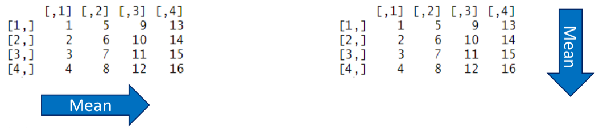
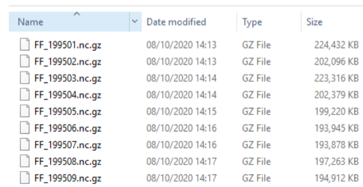
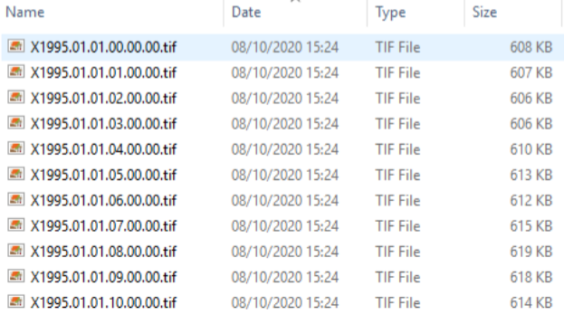
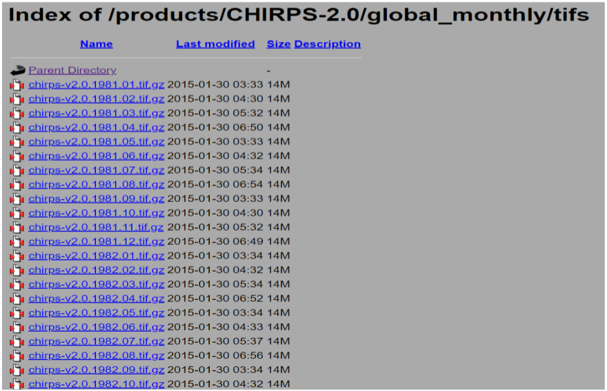
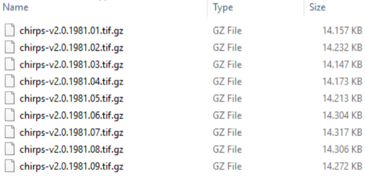

```{r setup, include=FALSE}
knitr::opts_chunk$set(collapse =TRUE, size = "\\scriptsize")
options(tinytex.verbose = TRUE)
library(tools)
library(R.utils)
library(XML)
library(httr)
library(RCurl)
library(terra)
```

# Objective and contents

## Objective and contents

**Objective**: to automate the downloading of data in R as well as provide more information about some functions.

>- Web crawling with R
>- Iterative functions
>- Downloading Products trough ftps
>- Downloading Products trough https
>- Working with NCDF files

# Web crawling with R

## Web crawling with R

Web crawling is a method of finding web links originating from one URL or a list of URLs. In this sense, we will need to retrieve URLs to download specific datasets.

# Iterative functions

## The apply Function

The apply function enables us to perform quick operations on a matrix, vector or array.

- Computational time using this function (as well as all others from the "apply" family) is faster than when using loops.

The apply function works as follows:
```{r eval=FALSE}
apply(x, MARGIN, FUN)
```

## The apply Function

```{r eval=FALSE}
apply(x, MARGIN, FUN)
```

**x** is an array, including a matrix

**MARGIN** is a vector giving the subscripts over which the function will be applied. Note that for
a matrix, 1 indicates rows and 2 indicates columns

**FUN** is the function to be applied

## The apply Function

Let’s create small matrix to demonstrate how apply can be used.
```{r}
x <- matrix(1:16, nrow = 4)
print(x)
apply(x, 1, mean)
apply(x, 2, mean)
```

## The apply Function

    apply(x, 1, mean)                    vs                    apply(x, 2, mean)     

<center>
{width=90%}
</center>

## The lapply Function

In the lapply function, a function is applied to each element of the list. The output is a list which therefore has the same length as the object.

This function works as follows:
```{r eval=FALSE}
lapply(X, FUN)
```

**X** a vector or an object

**FUN** the function to be applied

## The lapply Function

Let’s create an object with plans for next winter to demonstrate the use of lapply.
```{r}
winter.plans <- c("Mountains", "Skiing", "Christmas Market", "Holiday")
# The output is a list of 4 elements (one for each string)
lapply(winter.plans, nchar)
```

The function *nchar* returns the number of characters in a string.

## The lapply Function

We can also use lapply on a list.
```{r}
number.list <-list(first = c(2, 4, 6), second = 10, third = c(40, 60, 80, 100))
lapply(number.list, sum)
lapply(number.list, cumsum)
```

## The lapply Function

Now, we'll see a more tangible use of *lapply*. We will again use the *rbind*` function to
combine population tables, but this time, for all files in a folder.
```{r eval=FALSE}
data_path    <- "C:/Users/L6_Automating_Downloading_Data/Cities"
cities_files <- list.files(data_path, full.names = TRUE)
cities       <- lapply(cities_files, read.csv, header = TRUE)
```
```{r echo=FALSE}
data_path    <- "../Data/L6_Automating_Downloading_Data/Cities"
cities_files <- list.files(data_path, full.names = TRUE)
cities       <- lapply(cities_files, read.csv, header = TRUE)
```

```{r}
summary(cities)
```

## The lapply Function

To create the combined table using the *rbind* function, we will also make use of the
*do.call* function.
```{r}
combined_table <- do.call(rbind, cities)
class(combined_table)
dim(combined_table)
head(combined_table)
```

## The mapply function

The *mapply* function is a multivariate version of *sapply*. It applies a function to all the elements sequentially.
- This gives us a way to call a non-vectorised function in a vectorised way-

This function works as follows:
```{r eval = FALSE}
mapply(FUN, ..., MoreArgs)
```

**FUN** the function to be applied
**...** multiple input arguments for mapply
**MoreArgs** other arguments that are needed for the function

## The mapply function

Here is an example to explain the use of mapply:

```{r}
# The function rep repeats an object n times. In
#  this case we are applying this function to a
#  vector (11:4) while n takes values from 3 to 6.
mapply(rep, 11:14, 3:6)
```

## The mapply function

If the length of the arguments are different, they will be "recycled".
```{r}
mapply(rep, 11:14, 3:4)
```

## The mapply function

Now, we will go back to the previous example, and use the mapply function to add the information about each country to the combined data table. First, we want the information about the country names and the number of entries for each country.
```{r, eval=FALSE}
library(tools)
country_names <- basename(file_path_sans_ext(cities_files))
```
```{r, echo=FALSE}
country_names <- basename(file_path_sans_ext(cities_files))
```

```{r}
no_entries <- unlist(lapply(cities, nrow))
print(country_names)
print(no_entries)
```

## The mapply function

```{r}
combined_table$Country <- unlist(mapply(rep, country_names, no_entries))
print(head(combined_table))
print(tail(combined_table))
```

## Advantages of using the apply family of functions

There are some advantages of using the apply family of functions compared to using for loops:

- They can make your code easier to read.

- They can make it easier to parallelise your code (i.e., designate processes to different cores of your computer).

- The code runs faster than for loops.

Note that there ways to parallelise your code using for loops. If you are interested in
this, refer to the **doParallel** package.

# Downloading Products trough ftps

## File Transfer Protocol

An FTP server offers access to a directory, with sub-directories. The FTP protocol is used to store, organise and share large amounts of data and therefore is used by many data providers to store and share their products.

<center>
{width=30%}
</center>

## Downloading CDC Data in R

**Step 1:** We want to use the packages **RCurl** and **R.utils**.
```{r, eval = FALSE}
install.packages("RCurl")
install.packages("R.utils")

library(RCurl)
library(R.utils)
```

The **RCurl** package provides functions to allow compose HTTP and FTP requests,while the **R.utils** package provides numerous useful functions. For this example, we need
the package to download and unzip the files.

## Downloading CDC Data in R

**Step 2:** Define the ftp path:
```{r}
ftp <- "ftp://opendata.dwd.de/climate_environment/CDC/grids_germany/hourly/Project_TRY/wind_speed/"
```

**Step 3:** Create a folder where you will store the files and save its path in the output.path
object.
```{r eval=FALSE}
output.path <- "C:/Users/Documents/Wind/Raw"
```
```{r echo=FALSE}
output.path <- "/home/oscarmbaez/Downloads/test"
```

## Downloading CDC Data in R

**Step 4:** Get the file names of all data. For this purpose we will use the *getURL* function
from the **RCurl** package.
```{r}
filenames <- getURL(ftp, ftplistonly = TRUE)
```

We can see that the result has all the URLs (that is, the parts after the FTP), but
everything is stored in one very long character string. To break up the character string, we can use the *strsplit* function.

```{r}
print(filenames)
```

## Downloading CDC Data in R

The *strsplit* function can be used to split the elements of a character vector. For example:
```{r}
words.with.oo <- "Moon, spoon, balloon, oodles, kazoo"
split.words   <- strsplit(words.with.oo, "oo")
```

Note that the output is a list.

## Downloading CDC Data in R

**Step 5:** Generate the FTPs to access each individual file.
```{r}
filenames <- paste0(ftp, strsplit(filenames, "\n")[[1]])
```

What is happening in this line of code?

- strsplit(filenames, "\r\n") splits the character vector every time there is the text "\r\n".

- Because the output of the strsplit function is a list, we need to use the double brackets to access the items.

- The URL needed to get a certain file is comprised of the character string we saved as FTP plus the part that responds to the file. Therefore, we use paste0 to create the full path.

## Downloading CDC Data in R

We can see that the ftps of interest only start in the third position of the object.
```{r}
print(filenames)

filenames <- filenames[grep(".nc.gz", filenames)]
print(filenames)
```

## Downloading CDC Data in R

**Step 6:** Download all the files. Here we will use the *mapply* function from earlier.
```{r, eval=FALSE}
mapply(download.file, filenames, destfile = file.path(output.path, basename(filenames)))
```

The files should start downloading and will be saved in designated folder

<center>
{width=30%}
</center>

## Downloading CDC Data in R

**Step 7:** Uncompress (unzip) the files.
```{r eval=FALSE}
mapply(gunzip, list.files(output.path, pattern = ".gz", full.names = TRUE))
```

Note that the default setting for the *gunzip* function will remove the zipped file after
the output file has been fully created.

Let's load the **terra** package.
```{r eval=FALSE}
library(terra)
```


## Downloading CDC Data in R

**Step 8:** Data organisation: we will extract all of the data from each .nc file and save each
layer as a separate *.tif* file in one folder. Let's open the first file that we downloaded:
```{r echo=FALSE}
output_path <- "../Data/L6_Automating_Downloading_Data/CDC"
```

```{r}
nc_files <- list.files(output_path, pattern = ".nc", full.names = TRUE)
jan1995  <- rast(nc_files[1])
print(jan1995)
```

## Downloading CDC Data in R
```{r fig.align='center', fig.height=4}
plot(jan1995)
```

## Downloading CDC Data in R

**Step 8:** Convert the NCDF file to GeoTiff:
```{r eval=FALSE}
processed.path <- "C:/Users/Documents/Wind/Processed"

for(i in 1:length(nc.files)){
  stacked.raster <- rast(nc.files[i])
  writeRaster(stacked.raster, paste0(processed.path, "/", names(stacked.raster), ".tif"), overwrite = TRUE)
}
```

<center>
{width=30%}
</center>

# Downloading Products trough https

## Example 2: Downloading CHIRPSv2

CHIRPSv2 precipitation data are available at the following ftp: https://data.chc.ucsb.edu/products/CHIRPS-2.0

In this example, we will look at the monthly datasets:
https://data.chc.ucsb.edu/products/CHIRPS-2.0/global_monthly/tifs/

<center>
{width=40%}
</center>

## Downloading CHIRPSv2

**Step 1:** We want to use the packages **httr** and **XML**.
```{r eval=FALSE}
install.packages("httr")
install.packages("XML")

library(httr)
library(XML)
```

The **httr** package provides useful tools for working with HTTP organised by HTTP
verbs, while the **XML** package provides approaches for both reading and creating XML and HTML
documents.

## Downloading CHIRPSv2

**Step 2:** Define the https path.
```{r}
path <- "https://data.chc.ucsb.edu/products/CHIRPS-2.0/global_monthly/tifs/"
```

**Step 3:** Create a folder where you will store the files and save its path in the output_path
object.
```{r}
output <- "C:/Users/Download_CHIRPS"
```

## Downloading CHIRPSv2

**Step 4:** We will use the function *GET* to retrieve the information from the specified url.
```{r}
df <- GET(path)
print(df)
```

## Downloading CHIRPSv2

**Step 5:** We will use the function content to retrieve the contents of a requested url. The request can be retrieved as a raw object, as text, and parsed into an R object where possible. If as is not specified, content does its best to guess which output is most appropriate.
```{r}
df <- content(df, as = "text")
print(df)
```

## Downloading CHIRPSv2

Step 6: We will use the function *readHTMLTable* extracts data from HTML tables in an
HTML document.
```{r}
df <- readHTMLTable(df)
head(df$indexlist)
```

## Downloading CHIRPSv2
```{r}
class(df)
names(df)
length(df)
```

## Downloading CHIRPSv2

**Step 7:** The objective is to store the names of the files in an object, so we will keep only
the first object from the df list.
```{r}
df <- df[[1]]
```

**Step 8:** We extract the object names from the data frame and just keep those that
include “chirps” using the grep function.
```{r}
names <- df$Name
names <- names[grep("chirps", names)]
head(names)
```

## Downloading CHIRPSv2

**Step 9:** Now, we can create the url of every element in the names vector.
```{r}
files <- file.path(path, names)
head(files)
```

## Downloading CHIRPSv2

**Step 10:** We can do something similar with the names of the output files and create the
full path of each file.
```{r}
output_names <- file.path(output, basename(files))
head(output_names)
```

## Downloading CHIRPSv2

**Step 11:** Download all the files. Here we will use the mapply function from earlier.
```{r eval=FALSE}
mapply(download.file, files, destfile = output_names)
```

The files should start downloading and will be saved in the designated folder.
<center>
{width=30%}
</center>

## Downloading CHIRPSv2

In case that the download is not working and you get a message saying:

    Timeout of 60 seconds was reached
    
You can use the *getOption* function to see the timeout set in R and change it with the *options* function.
```{r}
getOption('timeout')
options(timeout = 1000)
```

## Downloading CHIRPSv2

**Step 12:** Uncompress (unzip) the files.
```{r eval=FALSE}
mapply(gunzip, list.files(output, pattern = ".gz", full.names = TRUE))
```

Note that the default setting for the gunzip function will remove the zipped file after
the output file has been fully created.

# Packages in R

## Packages in R

There are more than 10,000 R packages published on [CRAN](https://cran.r-project.org/), so how do you know which ones to choose for your particular needs? We have already shown you the most common ones needed for the type of work that we often do:

- Work with shapefiles (sf, terra)

- Work with rasters (terra)

- Work with time series and hydrology (hydroGOF, hydroTSM)

- Visualise data (plotrix, maps, plotKML)

- Download products (RCurl, R.utils, MODIStsp, httr, XML)

## Packages in R

If you want to do something in R that can't be achieved with the packages we have already shown you, start with a Google search and see whether you need to use a function from a different package.

- Simply use *install.packages* to install any package that is needed and then *library* to load it.


