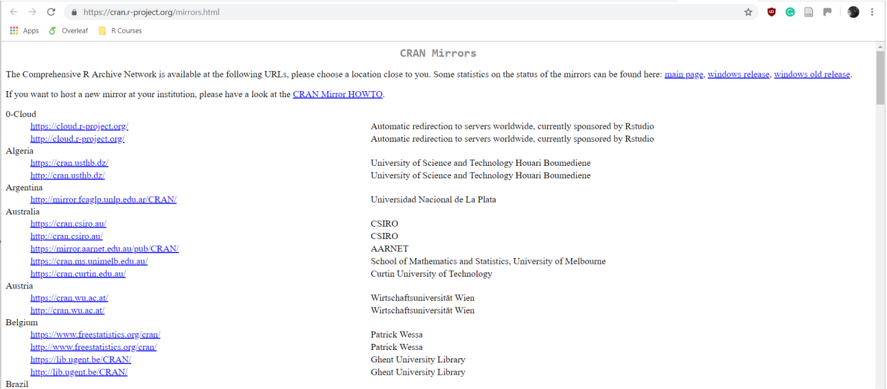
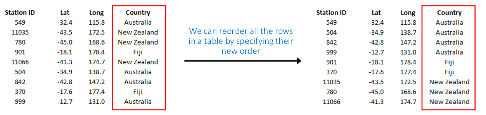
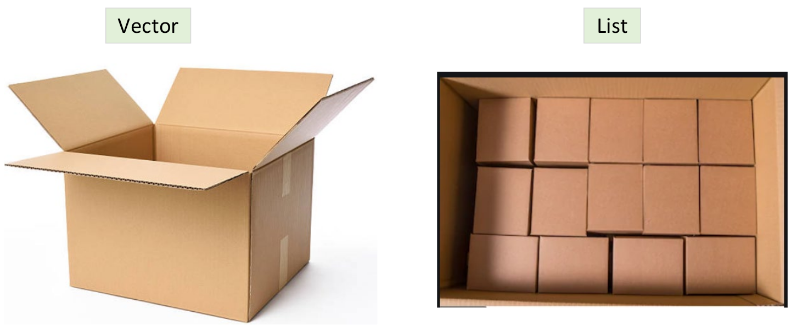

```{r setup, include=FALSE}
knitr::opts_chunk$set(collapse =TRUE, size = "\\scriptsize")
options(tinytex.verbose = TRUE)
```
# Objective and contents

## Objective and contents

**Objective:** to generate the basic knowledge for data analysis and interpretation using the R Project for Statistical Computing

**Contents:**

> - R and RStudio
> - Introduction to commands and assignment of variables
> - Vectors and sequences
> - Objects and their modes and attributes
> - Missing values
> - Some functions
> - Operators in R

## Objective and contents

**Contents:**

> - Index vectors
> - Matrices, lists, and data frames
> - Scripts and packages
> - Basic functions
> - Arithmetic operators


# What is R?

## Short introduction

The use of a programming language is useful when:

>  - Dealing with large datasets
>  - Dealing with data with high spatial resolution
>  - The method(s) must be applied over several regions
>    - Or applied over multiple time steps
>  - We want to achieve efficiency and automation

>  - ... and also for your employability after graduation!

## R and RStudio

R is a language and environment for statistical computing and graphics.

> - R provides statistical and graphical techniques
> - R incorporates statistical tests, models, and analyses
> - R was developed by statisticians and researchers
> - R is free and open source
> - R can be run in parallel (multi-core machines or network clusters)

## Installation

R is an open source software and can be [downloaded](https://cran.r-project.org/mirrors.html) for Linux, OS X (Mac) or Windows

<center>
{width=70%}
</center>

## Graphical User Interface

A Graphical User Interface allows the users to interact with electronic devices
through graphical icons instead of text-based user interfaces.

<center>
{width=70%}
</center>

## RStudio

RStudio is an integrated development environment for R, which is available in open
source and commercial editions and runs on Windows, Mac, and Linux.

<center>
{width=70%}
</center>

## Scripts

An R script is simply a text file containing (almost) the same commands that would be
entered on the command line of R. It allows the user to compute the same set of
actions continuously.

<center>
{width=40%}
</center>

## R Packages

Packages are collections of R functions, data, and complex code in a well-defined format.

- R has several packages already loaded
- If a new package is needed, it can be downloaded from CRAN, a repository where R packages are
available

As an example, we can install the **terra** package:
```{r, eval = FALSE}
install.packages("terra")
```

## R Packages

The installed packages must be loaded in order to use their functions. For this purpose,
the function *library* is used
```{r, eval = FALSE}
library("terra")
```

To remove an existing package:
```{r, eval = FALSE}
remove.packages(terra)
```

To visualise the installed packages and the packages in use:
```{r, eval = FALSE}
library()
search()
```

## Data in R

R is an interpreted language

> - This means that each written command is directly executed while all the data
(variables and results) are stored as objects (everything in R is an object)

> - The functions used in R are executed writing commands

The result of each command can be:

> 1. visualised directly on the screen
> 2. stored in an object
> 3. written on the hard disk

# R commands

## R commands

R is an expression language and is case sensitive; therefore *x* and *X* are different objects that refer to different variables

```{r}
x <- 10
X <- "This is a string"
print(x)
print(X)
```

The use of comments is very useful to know precisely what is happening in the script. The comments should always begin with the symbol *#*
```{r}
# This is a very useful comment
x <- 5 * 45
```

##

<center>
If a command is not complete, R will display the *+* symbol. It indicates that something is missing. In this case you can complete the command or press *Esc* to To cancel its execution.
</center>

## Recall of commands and data in R

To recall and execute previous commands, you can use the vertical arrow keys on the keyboard. This helps to apply or correct previous executed functions.

The data can be either visualised on the screen:
```{r}
5*5
```

Stored in an object:
```{r}
x <- 5*5
x <- "Hello world"
```

## Recall of commands and data in R

Or visualised on the screen by a plot:
```{r, fig.align='center', fig.height=4}
x <- 1:10; y <- 1:10
plot(x, y)
```

## Assignment of variables

There are many ways of assigning a value to a variable. The most common is the *<-* operator, which is composed by the less than character (*<*) and the minus character (*-*).
```{r}
n <- 5
print(n)
```

The *=* operator can be used as well.
```{r}
n <- "Mexico"
print(n)
```

## Assignment of variables

Additionally, the *assign* function can be also used.
```{r}
assign("n", 100)
print(n)

assign("a", "Hello guys!")
print(a)
```

# Vectors and sequences

## Vectors and sequences

A numeric vector is a ordered collection of numbers. To set up a vector is necessary to use the *c( )* function.
```{r}
x <- c(1, 2, 3, 4, 8, 5, 7)
print(x)
```

Similarly, we can create vectors that contain characters:
```{r}
x <- c("Oscar", "Manuel", "Baez", "Villanueva")
print(x)
```

## Vectors and sequences

Sometimes, we need to create long vectors that follow a know sequence. For example:
```{r}
x <- c(1, 2, 3, 4, 5, 6, 7, 8, 9, 10)
print(x)
```

For this purpose we can use the *:* symbol, which will create a sequence of consecutive integers. 
```{r}
x <- 1:10
print(x)
```

## Vectors and sequences

Other option is to use the *seq* function, which will create a sequence according to the desired step. 
```{r, eval = FALSE}
seq(from = 1, to = 1, by = ((to - from)/(length.out - 1)),
    length.out = NULL, along.with = NULL, ...)
```

For example:
```{r}
x <- seq(from = 1, to = 10, by = 1)
print(x)
x <- seq(1, 10, 0.5)
print(x)
```

# Mode and attributes

## Mode 

Objects are characterised by their name, content, and attribute. They represent the
data stored in them. The *mode* function identifies the kind of elements in the object. Each object has only one mode. There are 4 principal modes (atomic modes):

>  1. Numeric (e.g., 1, -5, 435, 28)
>  2. Character (e.g., "Hello", "B", "Oscar")
>  3. Logical (i.e., TRUE and FALSE)
>  4. Complex (e.g., 1i, 10i, 1$\sqrt{-1}$)


## Length

The command *length* indicates the amount of elements in an object.
```{r}
x <- "Evaporation"
length(x)
mode(x)
```

Which mode and length correspond to these elements?

Object   |   Mode    |    Length   
---------|-----------|-------------
58i      |           |             
Cadmium  |           |             
1:10     |           |             
TRUE     |           |             

## Length

The command *length* indicates the amount of elements in an object.
```{r}
x <- "Evaporation"
length(x)
mode(x)
```

Which mode and length correspond to these elements?

Object   |   Mode    |    Length   
---------|-----------|-------------
58i      | complex   | 1           
Cadmium  | character | 1             
1:10     | numeric   | 10             
TRUE     | logical   | 1             

## Class

All objects in R have a class, which can be retrieved with the **class** function. In the case of simple objects, the class is the same as the mode (e.g., "numeric", "character", and "logical"). For more complex object, the class will differ (e.g., "list", "array", "matrix", and "data.frame").
```{r}
a <- 1:100
class(a)
b <- c(TRUE, FALSE, TRUE)
class(b)
# Class from a predefined object
class(mtcars)
```

## Missing data

In some cases, there will be missing data in a set of values. These missing values are represented by the *NA* string. Please note that this is not a character.
```{r}
x <- c(1, 5, 7, NA, 8, 9)
mode(x)
x <- c(1, 5, 7, "NA", 8, 9)
mode(x)
```

## Infinite and Not a Number

*Inf* represents a non-finite numeric value.
```{r}
1/0
log(0)
```

Not a Number (NaN) represents values that should be numeric but they are not.
```{r}
sqrt(-1)
log(-5)
```

# Some functions

## Some functions

*abs*: absolute value of the object.
```{r}
abs(-1678)
```

*^n*: raise to the power of n.
```{r}
2^3
```

*sqrt*: square root of the object.
```{r}
sqrt(25)
```

## Some functions

*log*: natural logarithm.
```{r}
log(100)
```

*exp*: antilogarithm.
```{r}
exp(4.6051706)
```

*rep*: creates a vector of n times the object.
```{r}
rep("Hi", times = 6)
```

## Some functions

*basename*: returns the part of the file path after the last separator (/).
```{r}
data.path <- "C:/Users/Documents/WS_Sam_Neua/WS1_proj.tif"
basename(data.path)
```

*dirname*: returns the part of the file path before the last separator (/).
```{r}
dirname(data.path)
```

## Some functions

*paste*: used to paste multiple text strings together as one.
```{r}
paste("How", "are you?")
```

```{r}
num.days <- 31
paste("January has", num.days, "days.")
```

## Some functions

*paste0*: used to paste multiple text strings together as one without spaces.
```{r}
year <- 2010
month <- 12
file.name <- paste0("C:/Users/Documents/Result_", year, "-", month)
print(file.name)
```

## Some functions

*file.path*: Similar to paste and paste0, but will add forward slashes between each
input.
```{r}
file.path("C:/Users", "Folder")
```

*substr*: used to extract (or replace) substrings in a character vector.
```{r}
substr("Pink Floyd", 2, 6)

file.name <- "C:/Users/Documents/Result_2010-12.tif"
year <- substr(file.name, 27, 30)
print(year)
```

## Some functions

For this second example, we could combine the basename function as follows:
```{r}
yr <- substr(basename(file.name), 8, 11)
print(yr)
```
<center>
Why could this be beneficial?
</center>

## Some functions

To list files inside a folder, the function list.files can be used. Please copy the path
from a folder on your computer.
```{r, eval = FALSE}
list.files(path = ".", pattern = NULL, all.files = FALSE,
           full.names = FALSE, recursive = FALSE,
           ignore.case = FALSE, include.dirs = FALSE, no.. = FALSE)
```

For Example:
```{r, eval = FALSE}
list.files("C:/User/Data/L2_Introduction_II_Data/Cities")
```
```{r, echo = FALSE}
list.files("/home/oscarmbaez/Documents/Work/Work_2022/AGEP_course/Rcourses/R_Course_Material/Data/L2_Introduction_II_Data/Cities")
```

## Some functions

```{r, eval = FALSE}
list.files("C:/User/Data/L2_Introduction_II_Data/Cities", full.names = TRUE)
```
```{r, echo = FALSE}
list.files("/home/oscarmbaez/Documents/Work/Work_2022/AGEP_course/Rcourses/R_Course_Material/Data/L2_Introduction_II_Data/Cities", full.names = TRUE)
```

*Sys.time*: Prints the time and date. This can be useful when running long scripts, so
that you can work out how long a step or an entire script has taken to execute.
```{r}
Sys.time()
```

## Some functions

*t*: transposes a matrix.
```{r}
example <- matrix(c(1:20), nrow = 5)
print(example)
example.trans <- t(example)
print(example.trans)
```

## Some functions

*cumsum*: gives the cumulative sum from a vector.
```{r}
cumsum(c(1, 2, 3, 4))
```

*log10*: logarithm base 10.
```{r}
log10(100)
```

## Getting help

The function *help.start* will launch a Web browser that allows the help pages to be browsed with hyperlinks.
```{r, eval = FALSE}
help.start()
```

You don't need to memorise all information to include for each function. You can search the R documentation for a specific term with the question mark (*?*) before the function name.
```{r, eval = FALSE}
?sum
```

## Getting help

Additionally, the double question marks (*??*) search the R help files for a word or phrase.
```{r, eval = FALSE}
??sum
```

# Operators in R

## Operators in R

Two vectors can be added, subtracted, multiplied and divided:
```{r}
x <- 1:10
y <- 11:20
x + y
x - y
x * y
x / y
```

## Operators in R

*range*: gives the minimum and maximum values from a vector.
```{r}
range(x)
```

The functions max, min, mean, and var give the maximum, minimum, mean and
variance values from a vector, respectively.
```{r}
x <- -10:10
max(x)
min(x)
mean(x)
var(x)
```

## Operators in R

*sum*: gives the sum of any vector.
```{r}
sum(c(1, 2, 3, 4))
```

*prod*: gives the product of any vector.
```{r}
prod(c(1, 2, 3, 4))
```

## Operators in R

*sort*: sorts the values increasing (by default) or decreasing (decreasing = TRUE).
```{r}
y <- c(5, 3, 6, 8, 3, -1)
sort(y)
sort(y, decreasing = TRUE)
```

Please sort the following vector in an increasing and decreasing manner:

5, 9, 12, -10, -5, 3, 900

## Operators in R

*order*: this works similar to the sort function, but rather that returning the reordered
values themselves, it returns the positions of these values.
```{r}
y <- c(5, 3, 6, 8, 3, -1)
order(y)
```

## Operators in R

When can we use order instead of sort?

<center>

</center>

## Index vectors

The squared brackets (*[]*) can be used to subset elements from a vector.
```{r}
x <- c(10, 12, 13, 13, 17, 18, 18, 18, 21, 22)
x[1]
x[c(1, 2, 3)]
```

To extract everything but one or more selected element or elements, we can use the
minus symbol inside the square brackets:
```{r}
x[-1]
x[-c(1, 4, 7)]
```

## Index vectors

From the same vector please extract:

> - The fifth element
> - The third, sixth, and eighth
> - Everything except the tenth

## Unique Values in a Vector

To show all the unique values in a vector, we can use the *unique* function.
```{r}
x <- c(10, 12, 13, 13, 17, 18, 18, 18, 21, 22)
unique(x)
```

## The which function

In order to find the position of a specific object (e.g., numerical values, character
values) in a vector, the *which* function is used.
- If the requested object does not exist in the vector, the output vector has no values inside it
```{r}
x <- c(10, 12, 13, 13, 17, 18, 18, 18, 21, 22)
which(x == 18)
which(x > 17)
which(x == 9)
```

## The which function

To know the position of values that are not equal to a specific object, we can use the
*which* function together with the logical operator not equal to “!=”.
```{r}
x <- c(10, 12, 13, 13, 17, 18, 18, 18, 21, 22)
which(x != 18)
```
Note: when you want to search for multiple values within an object, it is better to
use the %in% function (see Lecture 4).

# Matrices, lists, and data frames

## Matrices

A matrix is a bidimensional array. It can be created with the *matrix* function.
```{r}
# Matrix with 5 rows and 2 columns and number 10 as a value
x <- matrix(10, nrow = 5, ncol = 2)
print(x)
```

## Matrices

With the *rnorm* function, we can create random values with a normal distribution. We
can use this function to create a matrix of 60 random values:
```{r}
# Matrix with 12 rows and 5 columns and random values
x <- matrix(rnorm(60), nrow = 12)
print(x)
```

## Matrices

Extracting values from a matrix is similar to extracting values from a vector; however, a matrix has two dimensions [row number, column number].
```{r}
print(x)
x[9, 3]
```

## Matrices
```{r}
print(x)
x[, 1]
```

## Matrices
```{r}
print(x)
x[3, ]
```

## Matrices
```{r}
print(x)
x[c(1, 2), 4]
```

## Matrices
```{r}
print(x)
x[c(3, 4), c(1, 2)]
```

## Lists

A list is an ordered collection of objects known as components, which can be
from different classes.
```{r}
my.list <- list(name = "T Rex", period = "Cretaceous", dinos.eaten = c(8, 12, 18))
print(my.list)
```

## Lists

The elements of a list are always enumerated. To access to each level of a list:
```{r}
my.list$name
my.list$period
my.list$dinos.eaten
```

Also, they can be accessed using their respective position:
```{r}
my.list[[3]]
```

## Why double square brackets?

<center>

</center>

## Lists

```{r}
my.list[[3]]
```

Now that we have the numbers for the dinos.eaten, how can we extract the 12?
```{r}
a <- my.list[[3]]
print(a)
a[2]

# OR:
my.list[[3]][2]
```

## Data frames

A data frame is a table or a two-dimensional array-like structure in which each column
contains values of one variable and each row contains one set of values from each
column.

> 1. The column names should be non-empty
> 2. The row names should be unique
> 3. The data stored in a data frame can be numeric, factor, or character
> 4. Each column must have the same number of data items

## Data frames

To construct a data frame, the function *data.frame* is used.
- As an example, we have the following information:
 
River    |   Length(km)      |     Discharge (m$^3$/s)
---------|-------------------|-------------------------
Congo    | 4370              | 41200
Mekong   | 4023              | 16000
Rhine    | 1233              | 2900

```{r}
river.data <- data.frame(River = c("Congo", "Mekong", "Rhine"),
                         Length = c(4370, 4023, 1233),
                         Discharge = c(41200, 16000, 2900))
print(river.data)
```

## Data frames

Using the *$* symbol, we can extract data from a certain column.
```{r}
river.data$Length
river.data$Length[3]
river.data[,2]
```

## Data frames

The *$* sign can also be used to create a new data column. Here, we will convert
discharge from m 3 /s into BMC/year and store it in a new data column.
```{r}
river.data$Discharge_BCMyear <- river.data$Discharge * 365.25* 24 * 60 * 60 / 10^9
print(river.data)
```

# Scripts and packages

## Running Scripts

> - The command *Ctrl +* Enter will run (same as the "Run" button on the top right of the
script area):
> - The line of the code that you are on
> - All the code that is selected by clicking and dragging
> - The command *Ctrl + Shift + s* will run the entire script (same as the *Source* button
on the top right of the script area)


