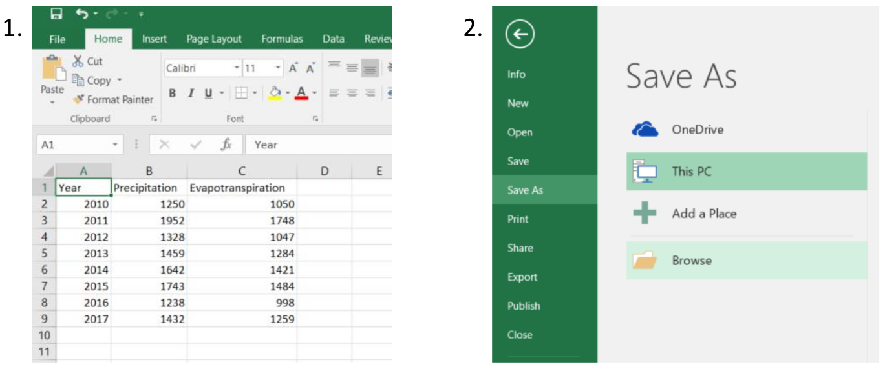
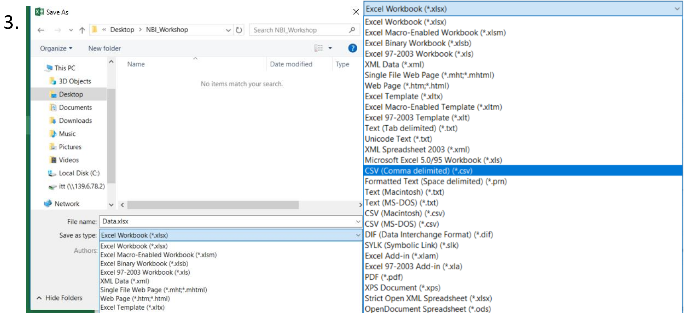
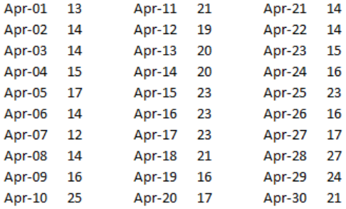
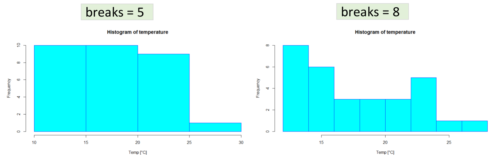
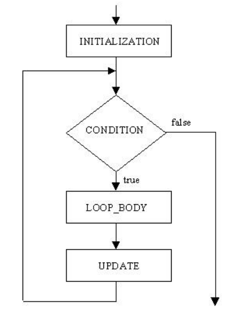
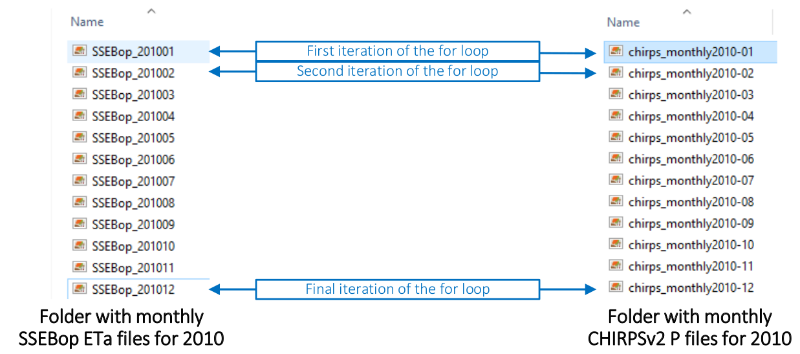

```{r setup, include=FALSE}
knitr::opts_chunk$set(collapse =TRUE, size = "\\scriptsize")
options(tinytex.verbose = TRUE)
```
# Objective and contents

## Objective and contents

**Objective:** to generate the basic knowledge for importing, modifying, writing and
plotting data as well as writing loops using the R Project for statistical computing.

**Contents:**

> - Importing and exporting data
> - Basic plots with R
> - Relational operators
> - Iterative processes

# Importing and exporting data

## Importing data

To import data to R we can use the *read.table* function, which returns a data frame object.
```{r, eval = FALSE}
read.table(file, header = FALSE, sep = "",
           dec = ".", row.names, col.names, na.strings = "NA",
           skip = 0, stringsAsFactors = FALSE, ...)
```

**file**: the name of the file which the data are going to be read from.

**header**: a logical value indicating whether the file contains the name of the variables as
its first line.

**sep**: the field separator character. Values on each line of the file are separated by this
character.

## Importing data

```{r, eval = FALSE}
read.table(file, header = FALSE, sep = "",
           dec = ".", row.names, col.names, na.strings = "NA",
           skip = 0, stringsAsFactors = FALSE, ...)
```

**dec**: the character used in the file for decimal points.

**na.strings**: a character vector of strings which are to be interpreted as NA values.

**stringsAsFactors**: [Logical] should character vectors be converted to factors?

Remember, if we don’t add one of these inputs, the default setting will be used.

## Importing data

Let's create a table in Excel

<center>
{width=70%}
</center>

## Importing data

Save the table as a csv file:

<center>
{width=70%}
</center>

## Importing data

We use the path of the file in the read.table function.
```{r, echo = FALSE}
p_eta_table <- data.frame(Year=c(2010:2017),
                          Precipitation=c(1250, 1952, 1328, 1459, 1642, 1743, 1238, 1432),
                          Evapotranspiration=c(1050, 1748, 1047, 1284, 1421, 1484, 998, 1259))
           
```

```{r, eval=FALSE}
data.path <- "C:/Users/Example/Data.csv"
p_eta_table <- read.table(data.path, header = TRUE, sep = ",")
```
```{r}
print(p_eta_table)
```

## Importing data

We could also use the read.csv function:
```{r, eval = FALSE}
p_eta_table <- read.csv(data.path)
```
```{r}
print(p_eta_table)
```

## Read Table, CSV and CSV2 - Default Settings

The *read.table*, *read.csv* and *read.csv2* functions, can be used to import data. Note that the *read.csv* and *read.csv2* functions come from *read.table* but have different default settings.

                 read.table     header = FALSE, sep = " "

                 read.csv       header = TRUE, sep = ","

                 read.csv2      header = TRUE, sep = ";"

##  Working with data frames

*dim*: returns the number of rows and columns (i.e. the dimensions) of the object.
```{r}
dim(p_eta_table)
```

Now we can add a new column to the existing data frame. As an example, we will
calculate the values of precipitation minus evapotranspiration:
```{r}
p_eta_table$P_minus_ETa <- p_eta_table$Precipitation - p_eta_table$Evapotranspiration
```

##  Working with data frames
```{r}
print(p_eta_table)
```

##  Working with data frames

Accessing data is the same for matrices and data frames. For example, to extract the value located in the second row and fourth column:
```{r}
p_eta_table[2, 4]
```

Or:

```{r}
p_eta_table$P_minus_ETa[2]
```

##  Working with data frames

Also we can subset the first three values of the third row.
```{r}
p_eta_table[3, 1:3]
```

Or make a subset of the data frame.
```{r}
p_eta_table[c(7, 2, 4), ]
```

## Export data

For exporting data, we can use the *write.table* function, which writes a data frame to a file or connection.
```{r, eval=FALSE}
write.table(x, file = "", append = FALSE, quote = TRUE, sep = " ",
            na = "NA", dec = ".", row.names = TRUE, ...)
```

**x**: the object to be written. Preferably a matrix or data frame. 

**file**: the file path where we want to save the file (including file name and extension). 

**append**: [Logical] only relevant if the file is a character string. If TRUE, the output is
appended to the file. If FALSE, any existing file of the name is destroyed. 

## Export data

```{r, eval=FALSE}
write.table(x, file = "", append = FALSE, quote = TRUE, sep = " ",
            na = "NA", dec = ".", row.names = TRUE, ...)
```

**quote**: [Logical] if TRUE, any character or factor columns will be surrounded by double
quotes.

**sep**: the field separator string. Values within each row of x are separated by this string.

**na**: the string to use for missing values in the data.

## Export data

```{r, eval=FALSE}
write.table(x, file = "", append = FALSE, quote = TRUE, sep = " ",
            na = "NA", dec = ".", row.names = TRUE, ...)
```

**dec**: the string to use for decimal points in numeric or complex columns: must be a
single character.

**row.names** and **col.names**: [Logical] indicating whether the names are to be written
along with x, or a character vector of names to be written.

## Export data

Now, we will save the table that we have edited.
```{r, eval=FALSE}
write.table(p_eta_table, paste0(dirname(data.path), "/table_modified.csv"),
row.names = FALSE, sep = ",")
```

Now, you can go to the corresponding folder and check whether the file has been written.

## Export data

Additionally, we can save a single R object to a connection and later on restore it by using the *saveRDS* and *writeRDS* functions.
```{r, eval = FALSE}
saveRDS(p_eta_table, paste0(dirname(data.path), "/table_modified.rds"))
x <- readRDS(p_eta_table, paste0(dirname(data.path), "/table_modified.rds"))
```

## Joining tables

We can use the *bind* function to combine the rows from two separate tables to form one
table. For this example, we will load tables with the most populous cities from both Spain and
Italy.
```{r, eval = FALSE}
spain.pop <- read.csv("...add file path…/Cities/Spain.csv", header = TRUE)
italy.pop <- read.csv("...add file path…/Cities/Italy.csv", header = TRUE)
```
```{r, echo = FALSE}
spain.pop <- read.csv("../Data/L2_Introduction_II_Data/Cities/Spain.csv", header = TRUE)
italy.pop <- read.csv("../Data/L2_Introduction_II_Data/Cities/Italy.csv", header = TRUE)
print(spain.pop)
```

## Joining tables

First, let's add information about the country to the table, so that the combined table will
include the country for each entry.
```{r}
spain.pop$Country <- rep("Spain", times = nrow(spain.pop))
italy.pop$Country <- rep("Italy", times = nrow(italy.pop))
print(spain.pop)
print(italy.pop)
```

## Joining tables

Now we can use the *rbind* function to join the tables.
```{r}
pop.table <- rbind(spain.pop, italy.pop)
```

Similarly, the *cbind* function will combine objects by columns.

# Basic plots with R

## Basic plots with R

The *plot* function is a generic function. This means that the type of plot produced is
dependent on the type or class of the first argument.
```{r, eval = FALSE}
plot(x, y, type, main, sub, xlab, ylab)
```

**x**: the coordinates of points in the plot (x-axis)
**y**: the coordinates of points in the plot (y-axis)
**main**: a title for the plot
**sub**: a subtitle for the plot
**xlab** and **ylab**: titles for the x and y axes

Note: **y** can be omitted if **x** has the appropriate structure (e.g., for a raster file)

## Basic plots with R

**type**: what type of plot should be drawn. Possible types are:

> a) “p” for points
> c) “b” for both (points and lines) b) “l” for lines
> d) “c” for the lines part alone of “b”
> e) “o” for overplotted
> g) “s” for stair steps
> i) “n” for no plotting f) “h” for histogram like
> h) “S” for other steps

## Basic plots with R

To show the first set of plotting examples, we will read a csv file with World Bank data
for annual mean cereal crop yield for both the world and for Germany.
```{r, echo = FALSE}
crop.yield <- read.csv("../Data/L2_Introduction_II_Data/Cereal_Yield.csv")
```
```{r, eval = FALSE}
crop.yield <- read.csv("...add file path.../Data/Cereal_Yield.csv")
print(crop.yield)
```

When we have a lot of data entries in stored in an object, we can use the
*head* and *tail* functions to look at the first six and last six entries, respectively.

Note: the values presented are in kg/ha.

## Basic plots with R

```{r}
head(crop.yield)
tail(crop.yield)
```

## Line charts

Let's start with a line chart for the global values.
```{r fig.align='center', fig.height=3}
plot(crop.yield$Year, crop.yield$Global_Cereal_Yield, type = "l")
```

Note: we will get the same result by selecting the column numbers
instead of the names: i.e., plot(crop.yield[,1], crop.yield[,2], type = "l").

## Line charts

Now, we will redo the plot in a more customised manner (chart title, axes titles, user
defined minimum and maximum axis values).
```{r fig.align='center', fig.height=3}
plot(crop.yield$Year, crop.yield$Global_Cereal_Yield, type = "l",
main = "Mean Cereal Yield", xlab = "Year",
ylab = "Mean yield (kg/ha)", ylim = c(0, 10000))
```

## Line charts

The lines function is used to add another line to an existing plot. The legend function is used to add a legend to the plot.
```{r, eval=FALSE}
lines(crop.yield$Year, crop.yield$German_Cereal_Yield, col = "red")
legend("topleft", c("Global", "Germany"), lty = 1, col = c("black", "red"))
```

```{r, echo = FALSE, fig.align='center', fig.height=3}
plot(crop.yield$Year, crop.yield$Global_Cereal_Yield, type = "l",
main = "Mean Cereal Yield", xlab = "Year",
ylab = "Mean yield (kg/ha)", ylim = c(0, 10000))
lines(crop.yield$Year, crop.yield$German_Cereal_Yield, col = "red")
legend("topleft", c("Global", "Germany"), lty = 1, col = c("black", "red"))
```

## Adding Points to a Graph

The points function is used to add points to an existing plot. 
*pch* selects to the plotting character and *col* the plotting colour.
```{r, eval=FALSE}
points(x = c(1990, 2000, 2010), y = c(3000, 4000, 6000),
        pch = 20, col = c("red", "blue", "black"))
```
```{r, echo = FALSE, fig.align='center', fig.height=3}
plot(crop.yield$Year, crop.yield$Global_Cereal_Yield, type = "l",
main = "Mean Cereal Yield", xlab = "Year",
ylab = "Mean yield (kg/ha)", ylim = c(0, 10000))
points(x = c(1990, 2000, 2010), y = c(3000, 4000, 6000),
        pch = 20, col = c("red", "blue", "black"))
```


## Scatter Plots

Example: we can also plot the information using a scatter plot.
```{r fig.align='center', fig.height=3}
plot(crop.yield$Year, crop.yield$Global_Cereal_Yield, type = "p")
```

Note: the default plot option is with points. Therefore, if we do not specify the type, we will have the same result.

## Histograms

A histogram is a graphical representation of the distribution of numerical data.
- It is an estimate of the probability distribution of a continuous variable.

Example: the daily temperature values (in °C) for April in a particular city are:

<center>

</center>

## Histograms

```{r}
temp <- c(13, 14, 14, 15, 17, 14, 12, 14, 16, 
          25, 21, 19, 20, 20, 23, 23, 23, 21, 
          16, 17, 14, 14, 15, 16, 23, 16, 17, 
          27, 24, 21)
```

## Histograms

The function *hist* will generate a histogram.
```{r fig.align='center', fig.height=4}
hist(temp)
```

## Histograms

Again, we can customise the histogram.
```{r fig.align='center', fig.height=4}
hist(temp, main = "Histogram of temperature in April", xlab = "Temp [°C]",
border = "blue", col = "cyan", breaks = 8)
```

## Histograms

Remember to think carefully about how you plot and analyse your data
- Looking at the previous example, if we plot the data with 5 breaks and with 8 breaks:

<center>

</center>

## Boxplots

The function *boxplot* produces box-and-whisker plot(s) of (grouped) values.
```{r fig.align='center', fig.height=3}
boxplot(temp)
```

## Boxplots

Now, we will load daily values for maximum temperature in a pilot city.
```{r, echo = FALSE}
daily.temp <- read.csv("../Data/L2_Introduction_II_Data/Daily_Temp.csv")
```
```{r, eval = FALSE}
daily.temp <- read.csv("C:/Users/Data/Daily_Temp.csv")
```
```{r}
print(daily.temp)
```

## Boxplots 

To generate a *boxplot* with the data:
```{r fig.align='center', fig.height=4}
boxplot(daily.temp, main = "Daily Max. Temp of Pilot City in 2011",
col = "cyan", ylab = "Max temp (degrees C)")
```

## Bar charts

The *barplot* function creates a bar chart with vertical or horizontal bars.
```{r fig.align='center', fig.height=4}
barplot(crop.yield$Global_Cereal_Yield)
```

## Bar charts

Let's customise the bar chart.
```{r fig.align='center', fig.height=4}
barplot(crop.yield$Global_Cereal_Yield, main = "Global Cereal Yield",
sub = "Data from World Bank", xlab = " Year", ylab = "Yield (kg/ha)", names.arg = crop.yield$Year)
```

## Bar charts

Some other options to change how your data is presented in a bar chart:

- **col** to add colour to the plot

- **horiz** to create a horizontal bar chart (set to TRUE)

```{r, eval=FALSE}
x <- c(8, 5, 10)
barplot(x, main = "Example of Horizontal Bar Chart",
names.arg = c("A", "B", "C"), horiz = TRUE,
ylab = "number", col = c("red", "blue", "yellow"))
```
## Bar charts

```{r, echo=FALSE, fig.align='center'}
x <- c(8, 5, 10)
barplot(x, main = "Example of Horizontal Bar Chart",
names.arg = c("A", "B", "C"), horiz = TRUE,
ylab = "number", col = c("red", "blue", "yellow"))
```

## Pie charts

The function pie draws a pie chart.
```{r fig.align='center', fig.height=3.5, fig.width=4}
slices <- c(10, 12, 4, 16, 8)
country <- c("Canada", "UK", "Australia", "Germany", "France")
pie(slices, labels = country)
```

## Pie charts

More personalised:
```{r  fig.align='center', fig.height=4, fig.width=4}
pie(slices, labels = country, main = "Pie chart of countries",
col = rainbow(length(slices)))
```

# Relational operators

## Relational operators

R uses the following relational operators:

    <     lower than
    >     greater than
    <=    lower than or equal to
    >=    greater than or equal to
    ==    equal to
    !=    not equal to

For example:
```{r}
5 > 4
2 + 2 == 5
```

# Iterative processes

## Iterative processes

Loops are very important because they allow us to do the following:

- Only run a certain code if a condition is met (if)

- Run the same process a specified number of times (for)
  - A common example is to run the same code for each time step
  
- Continue running a process until a condition is met (while)

# Iterative processes

<center>
{width=30%}
</center>

## If statements

R is able to perform conditional executions of the form:
```{r, eval=FALSE}
if (conditional statement)  process 1 else process 2
```

The conditional statement must evaluate a single logical value, the process 1 will be run if the condition is met, while the process 2 will run when the condition is not met. 

## If statements

For example:
```{r}
if(5 > 4) print("Yes") else print("No")
```

Or:
```{r}
if(5 > 4)
  print("Yes") else
    print("No")
```

## If statements

If the processes contained in the condition require multiple lines, they should be written inside of curly brackets.
```{r}
if(5 > 4){
  x <- 5
  y <- x * 10
  print(y)
} else {
  x <- 2
  y <- x * 5 
  print(y)
  
}
```

## If statements

Note that the else statement is not always required:
```{r}
x <- 5
if(x > 4){
  y <- x *10
  print(y)
}
```

## If statements

An example of an else clause within an if loop is as follows:
```{r}
input.value <- 32
if(input.value > 0){
  result <- log(input.value)
  paste("The log of", input.value, "is equal to", result)
} else {
  paste("Input value is negative, therefore no log value can be calculated")
}
```

## If statements
Sometimes, we want to run a loop if any one of a set of conditions is met.
```{r}
day <- "Monday"

if(day == "Saturday" | day == "Sunday"){
  response <- paste("No alarm set for the weekend")
} else {
  alarm.time <- "7am"
  response <- paste("My alarm will be set for", alarm.time)
}

print(response)
```


## For loops

The *for* loop has the form:
```{r, eval = FALSE}
for(variable in vector) process
```

The variable will be iterated during the for loop taking each one of the values defined in the vector. The process will be applied in each iteration. For example:
```{r}
for(i in 1:5) print(i)
```

## For loops

Similarly to the if statement, if the process has more than one line of code, it should be surrounded by curly brackets.
```{r}
for(i in 1:5){
  x <- i^2
  y <- x * 5
  print(y)
}
```

## For loops

If you write a loop within a loop, we refer to this as a **nested loop**,
```{r, eval = FALSE}
for(i in 1:10){
  for (j in 1:5){
    a <- i + j
    cat(i, "plus", j, "is equal to", a, "\n")
}
  cat("------------------------ \n")
}
```

## For loops

We can use a *for* loop in a spatial time series analysis.

<center>
{width=70%}
</center>

## While loops

The *while* loop has the form:
```{r, eval = FALSE}
while(condition) process
```

The condition will be evaluated, if it is true, the process will be run. When the condition is not longer met, the while loop will stop. 

## While loops

For example:
```{r}
delta <- 0.75
x     <- 1
while(delta < x){
  x <- x - 0.05
  print(x)
}
```


