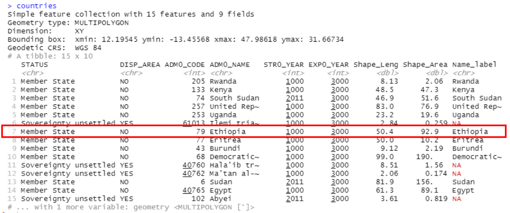
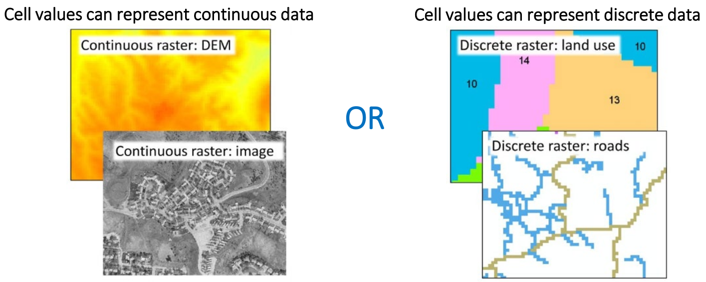
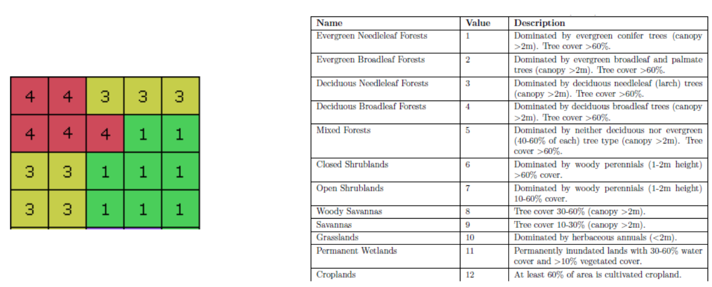
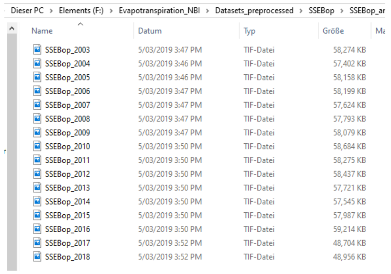
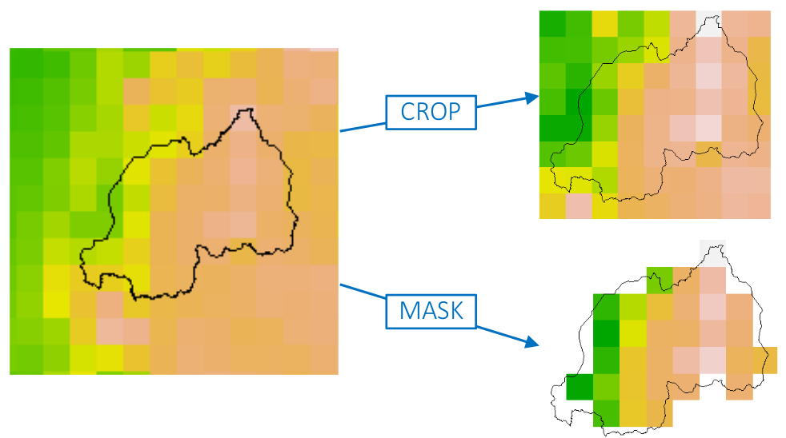
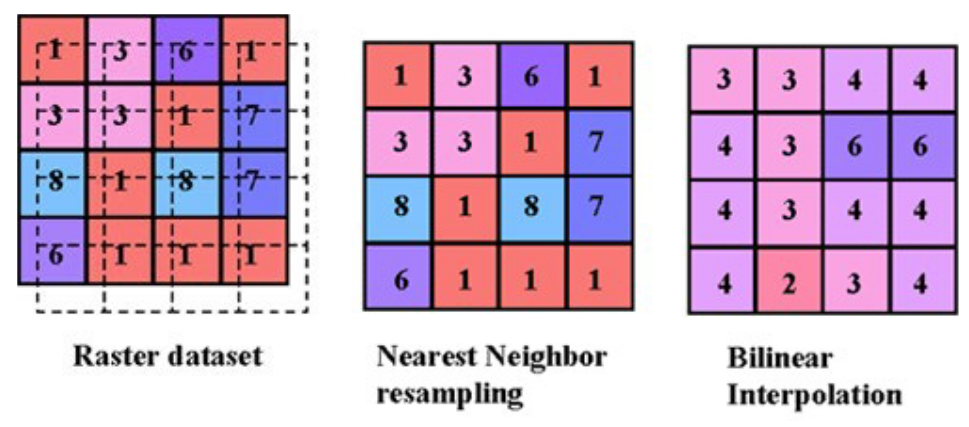
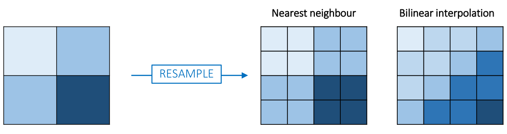
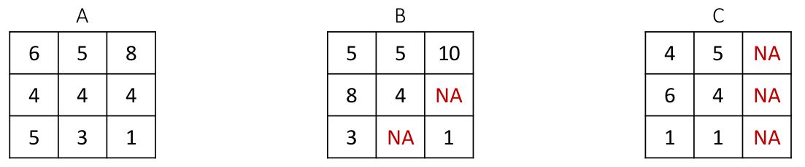
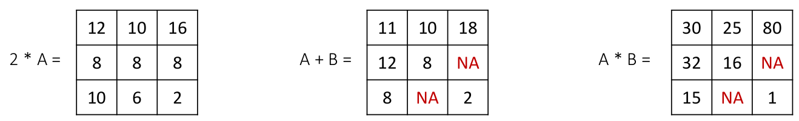
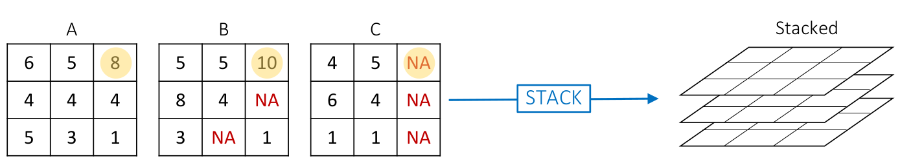

```{r setup, include=FALSE}
knitr::opts_chunk$set(collapse =TRUE, size = "\\scriptsize")
options(tinytex.verbose = TRUE)
library(sf)
library(terra)
library(tibble)
library(dplyr)
library(sp)
```

# Objective and contents

## Objective and contents

**Objective**: to learn how to manipulate gridded datasets and vectorised data through the application of the most important functions in R.

> - Importing and plotting vector data
> - Extract specific spatial information using vector data
> - Importing gridded datasets
> - Manipulation of gridded datasets
> - Exporting gridded datasets in different formats
> - Manipulation of values in gridded data

# Importing and plotting vector data

## Vector data

Vector data stores the location, shape, and attributes of geographic features in one of the following forms:

- Points
- Lines
- Polygons

There are different packages that can be used to load and manipulate vector data (shapefles) in R. In this lecture, we will use the **sf** and **terra** packages. The **tibble** package can also be installed as it is used by **sf**. 

## Vector data

To install these packages we can use the *install.packages* function.
```{r, eval=FALSE}
install.packages("sf")
install.packages("tibble")
install.packages("terra")
```

Once they are installed, we can load them with the *library* function.
```{r, eval=FALSE}
library(sf)
library(tibble)
library(terra)
```

## Vector data

To read vector data in R, we can use both packages. To use the **sf** package we can apply the *read_sf*
```{r, echo=FALSE}
countries <- read_sf("../Data/L3_Rasters_and_Shapefiles_Data/Countries")
```
```{r, eval=FALSE}
countries <- read_sf("C:/User/Data/L3_Rasters_and_Shapefiles_Data/Countries")
```

If the folder contains more than one shapefile, you have to specify the file path:
```{r, eval=FALSE}
countries <- read_sf("C:/User/Data/L3_Rasters_and_Shapefiles_Data/Countries/Nile_Basin_Countries_GAUL_2014_2.shp")
```

## Vector data

If we type the name of the object in the console:
```{r}
countries
```

## Vector data

Let's plot the countries object:
```{r fig.align='center', fig.height=4}
plot(countries)
```

## Vector data

The function names will return the names of all the attributes stored.
```{r}
names(countries)
```

## Simple Features in R

**sf** objects are data frames with a special “geometry” column:
```{r}
st_geometry(countries)
```

## Simple Features in R

Since geometries are not single-valued, they are put in a list-column, with each list
element holding the simple feature geometry of that feature.
The three classes used to represent simple features are:

> - **sf**, the table (data.frame) with feature attributes and feature geometries, which contains

> - **sfc**, the list-column with the geometries for each feature (record), which is composed of

> - **sfg**, the feature geometry of an individual simple feature

## Simple Features in R

If we want to plot the geometry only:
```{r fig.align='center', fig.height=4}
countries_geom <- st_geometry(countries)
plot(countries_geom, axes = TRUE)
```

## Simple Features in R

We can also define the limits for the x-axis and y-axis of the plot.
```{r fig.align='center', fig.height=3}
countries_geom <- st_geometry(countries)
plot(st_geometry(countries), axes = TRUE,
xlim = c(20, 40), ylim = c(1, 20))
```

## Simple Features in R

If we want to plot a single attribute:
```{r fig.align='center', fig.height=3}
plot(countries["Shape_Area"], axes=TRUE)
```

Many more possibilities: [https://r-spatial.github.io/sf/articles/sf5.html](https://r-spatial.github.io/sf/articles/sf5.html)


# Extract specific spatial information using vector data

## Extracting Polygons (or Features) from Shapefiles

Every row contains a single feature:

<center>
{width=60%}
</center>

## Extracting Polygons (or Features) from Shapefiles

To get a simple feature containing only Ethopia:
```{r}
ethiopia <- countries[7, ]
print(ethiopia)
```

## Extracting Polygons (or Features) from Shapefiles

```{r fig.align='center', fig.height=4}
plot(ethiopia)
```

## Reading vector data with the terra package

When we want to manipulate raster and vector data altogether, the **terra** package is very useful. To read vector data with this package we will use the *vect* function.
```{r, echo=FALSE}
countries <- vect("../Data/L3_Rasters_and_Shapefiles_Data/Countries/Nile_Basin_Countries_GAUL2014_2.shp")
```
```{r, eval=FALSE}
countries <- vect("C:/User/Data/L3_Rasters_and_Shapefiles_Data/Countries/Nile_Basin_Countries_GAUL2014_2.shp")
```

## Exporting vector data

To save the extracted feature(s) in a specific address on your system, we can use the
*write_sf* function.
```{r, eval=FALSE}
write_sf(ethiopia, "C:/Users/Ethopida_outline/Ethiopia_outline.shp")
```

You can save into other formats with *st_write*. Look at the driver argument in the help.

## Manipulating attributes

We can get rid of the geometry with the *st_drop_geometry* function.
Calculating new attributes (e.g., mm/m2 to total per country):
```{r, echo=FALSE}
countries <- read_sf("../Data/L3_Rasters_and_Shapefiles_Data/Countries")
```
```{r, eval=FALSE}
countries <- read_sf("C:/User/Data/L3_Rasters_and_Shapefiles_Data/Countries")
```
```{r}
countries["precip_mm"] <- runif(nrow(countries))
countries_df <- st_drop_geometry(countries)
countries["precip_total"] <- countries_df["precip_mm"] * countries_df["Shape_Area"]
```

## Manipulating attributes

Alternatively, we can use **dplyr**:
```{r}
countries %>%
mutate(precip_ml = runif(nrow(countries)),
precip_total = precip_ml * Shape_Area)
```

# Importing gridded datasets

## Raster Files

A raster consists of a matrix of cells (or pixels), where each cell contains a value or set of values representing certain information.

<center>
{width=60%}
</center>

## Raster Files

Rasters with discrete data often use a code to represent different data types.

- For example, these are the values used for the MODIS Land Cover product to represent the IGBP classification (Loveland & Belward, 1997).

<center>
{width=60%}
</center>

##  Import raster files

To open a GeoTIFF raster file (or similar), the *rast* command from the **terra** package is used.
```{r, echo=FALSE}
gleam.path <- "../Data/L3_Rasters_and_Shapefiles_Data/GLEAM_annual/GLEAM_2009.tif"
gleam      <- rast(gleam.path)
```
```{r, eval=FALSE}
gleam.path <- "C:/User/L3_Rasters_and_Shapefiles_Data/GLEAM_annual/GLEAM_2009.tif"
gleam      <- rast(gleam.path)
```

To be able to perform raster operations, all the raster files involved will need to have the
same raster geometry:

> - Same spatial extent
> - Same spatial resolution
> - Same origin

## Raster Files - Coordinate reference system

The metadata of the raster file can be visualised by typing the name of the object where it was
stored (in this case gleam).
```{r}
print(gleam)
```

## Raster Files - Coordinate reference system

In R, information about the raster (coordinate system, spatial extent, number of grid-cells, etc.) can be easily retrieved or introduced using the *crs* function from the raster package:
```{r}
crs(gleam)
crs(gleam) <- "+proj=longlat +datum=WGS84 +no_defs +ellps=WGS84
+towgs84=0,0,0"
```

## Raster Files - Plotting a raster

To plot a raster we use the *plot* function.
```{r fig.align='center', fig.height=4}
plot(gleam)
```

## Raster Files - Plotting a raster

Alternatively, we can use the function click to get the value of a certain pixel.
```{r, eval=FALSE}
click(gleam)
```

To exit the click function please press **Esc**.

##  Raster Files

The package **terra** is able to work efficiently with a large number of raster files; therefore, Creating a multi-layer objects is extremely easy. 

The use of multi-layered gridded objects (stacks) is very useful in multiple cases (e.g., when working with rasters concerning environmental data such as precipitation, evapotranspiration and temperature).

##  Creating a multi-layered gridded object

We want to use these annual ETa files to:

- Create a stack with all annual files
- Calculate a multi-annual mean Ea raster

<center>
{width=40%}
</center>

# Manipulation of gridded datasets

## Manupulating a Raster Stack - Example

**Step 1:** List all the files within the folder.
```{r, echo = FALSE}
ssebop.path <- "../Data/L3_Rasters_and_Shapefiles_Data/SSEBop_annual"
ssebop.files <- list.files(ssebop.path, full.names = TRUE, pattern = ".tif")
```
```{r, eval = FALSE}
ssebop.path <- "C:/Users/Example/SSEBop_annual"
ssebop.files <- list.files(ssebop.path, full.names = TRUE, pattern = ".tif")
```
```{r}
head(ssebop.files)
```

## Manupulating a Raster Stack - Example

**Step 2:** Create a stack from all the single raster layers.
```{r fig.align='center', fig.height=3}
ssebop <- rast(ssebop.files)
plot(ssebop)
```

## Manupulating a Raster Stack - Example

<center>
Note: similar to with other data formats, we can use the function names to look at the names of the layers.
</center>

## Manupulating a Raster Stack - Example

**Step 3:** Calculate the multi-annual mean.
```{r fig.align='center', fig.height=3}
ssebop.multiannual <- mean(ssebop)
plot(ssebop.multiannual)
```

## Accessing Rasters from a Raster Stack

We currently have the raster stack saved as the object ssebop.
```{r}
print(ssebop)
```

## Accessing Rasters from a Raster Stack

Similar to a list, we use double square brackets to access a particular raster (or multiple
rasters) from a raster stack.
```{r}
print(ssebop[[2]])
print(ssebop[[1:3]])
```

## Cropping and Masking Rasters

- Cropping a raster (crop function) will extract the part of a raster within that rectangular area.
- Masking a raster (mask function), will extract the pixels within the shapefile.

<center>
{width=60%}
</center>

## Crop Function

The crop function extracts a portion of a gridded dataset according to a selected input (can be a raster or a vector file; i.e., SpatRaster and SpatVector, respectively).

To crop a raster:
```{r}
rwanda     <- countries[1, ]
rwanda     <- vect(rwanda)
gleam.crop <- crop(gleam, rwanda)
```

## Crop Function
```{r fig.align='center', fig.height=4}
plot(gleam.crop)
```

## Crop function

The parameter snap is used to align the cropped file to the extent of the selected element that is used to perform the crop.

- "near" (default)
- "in"
- "out"

```{r}
gleam.crop <- crop(gleam, rwanda, snap = "out")
```

## Crop function

```{r fig.align='center', fig.height=4}
plot(gleam.crop)
```

## Mask function

To mask a raster:
```{r fig.align='center', fig.height=3}
gleam.mask <- mask(gleam.crop, rwanda)
plot(gleam.mask)
```

## What Values are in my Raster?

To list all the unique values in a raster object, the *getValues* function is used.
- The output is in the form of a vector
```{r}
gleam_vals <- values(gleam.mask)
gleam_vals <- as.numeric(gleam_vals)
print(gleam_vals)
```

## Resample rasters

In order to perform raster operations, the raster geometry between the layers must be the same.

- A raster layer can be resampled using multiple methods.
- Here we focus on two: bilinear interpolation and nearest neighbour interpolation.

<center>
{width=60%}
</center>

## Resample rasters

The previous slide showed resampling to a different origin using the same grid-cell size.

- Resampling can also be used to change the spatial resolution of the raster layer.

<center>
{width=70%}
</center>

## Resample rasters

How to resample rasters in R.
- Nearest neighbour method (rasters with categorical or continous variables)
```{r, echo=FALSE}
land.cover <- "../Data/L3_Rasters_and_Shapefiles_Data/Land_cover/MCD12Q1_LC1_2009_001.tif"
land.cover <- rast(land.cover)
```
```{r, eval = FALSE}
land.cover <- "C:/Users/Example/MCD12Q1_LC1_2009_001.tif"
land.cover <- rast(land.cover)
```

```{r}
print(land.cover)
```

## Resample rasters

To resample the raster to the spatial resolution of the **gleam** object we will use the *resample* function.
```{r}
landcover.res <- resample(land.cover, gleam, method = "ngb")
```

## Resample rasters

```{r}
print(landcover.res)
```

## Resample rasters

```{r, fig.align='center', fig.height=4}
plot(landcover.res, xlim = c(10, 50), ylim = c(-15, 35))
```


## Resample rasters

How to resample rasters in R. Bilinear method (rasters with continuous variables).
```{r, echo=FALSE}
chirps <- "../Data/L3_Rasters_and_Shapefiles_Data/CHIRPS/chirps_monthly2009-01.tif"
chirps <- rast(chirps)
```
```{r, eval=FALSE}
chirps <- "C:/Users/Example/chirps_monthly2009-01"
chirps <- rast(chirps)
```

```{r}
print(chirps)
chirps.res <- resample(chirps, gleam, method = "bilinear")
```

## Resample rasters

```{r}
print(chirps.res)
```

## Resample rasters

```{r fig.align='center', fig.height=4}
plot(chirps.res, xlim = c(10, 50), ylim = c(-15, 35))
```


# Exporting gridded datasets

After we have altered a raster, we may want to save the new raster. This can be done with the *writeRaster* function (part of the **terra** package).
```{r, eval=FALSE}
writeRaster (x, filename, overwrite, ...)
```

**x:** raster object.
**filename:** output filename (with complete file path).
**overwrite:** logical.

## Exporting gridded datasets

Let's use the *writeRaster* function to save the resampled CHIRPS raster from the last exercise. We will save the raster as a GeoTiff file.
```{r, eval=FALSE}
writeRaster(chirps.res, "add file path", datatype = "INT1U", overwrite = TRUE)
```

Question: How could you make the file path name change according to the value of a variable?

# Manipulation of values in gridded data

## Raster Operations

Once rasters have the same geometry, it is easy to perform mathematical operations.
- Example - If we have the following three rasters:

<center>


</center>

## Raster Operations - NA values

Now, if we have these rasters in a stack:



What would be the result of the following expressions for the highlighted grid-cell: 

- mean(stacked, na.rm = TRUE)
- mean(stacked, na.rm = FALSE)

## Isolating Cells with Particular Attributes

We can identify the grid-cells with certain attributes. For example, the regions where
more than 200 mm of precipitation fell during January, 2009.
```{r fig.align='center', fig.height=3}
plot(chirps, main = "Precipitation January - 2009")
```

## Isolating Cells with Particular Attributes

For this purpose, we will set the values higher than 200 mm to equal 1 , while the
values lower or equal to 200 mm will be set to a value of 0.
```{r}
chirps.lim <- chirps
chirps.lim[chirps.lim <= 200] <- 0
chirps.lim[chirps.lim > 200]  <- 1
```

## Isolating Cells with Particular Attributes
```{r fig.align='center', fig.height=4}
plot(chirps.lim, main = "Regions with more than 200 mm for January - 2009")
```


## Isolating Cells with Particular Attributes   

```{r fig.align='center', fig.height=4}
plot(chirps.lim)
```

## Isolating Cells with Particular Attributes 

Another common use of this function is to create a raster where values are either 1 or NA
(hereafter, we will call this a "unitary" raster). In this example, we want to calculate the average
precipitation for January 2009 in the Nile Basin countries over the Arid region of the Köppen-Geiger major climate zones.
```{r, echo=FALSE}
climate.zones <- "../Data/L3_Rasters_and_Shapefiles_Data/Land_cover/MCD12Q1_LC1_2009_001.tif"
climate.zones <- rast(climate.zones)
```
```{r, eval=FALSE}
climate.zones <- "C:/Users/Example/NB_Major_CZ.tif"
climate.zones <- rast(climate.zones)
```


## Isolating Cells with Particular Attributes 
```{r fig.align='center', fig.height=4}
plot(climate.zones,
main = "Major climate zones")
```


## Isolating Cells with Particular Attributes 

Let's find unique values using the *values* function in combination with the *unique* function.
```{r}
uniq.values <- as.numeric(unique(values(climate.zones)))
print(uniq.values)
```

**Value** | **Climate**
----------|------------
1         | Tropical
2         | Arid
3         | Temperate
4         | Polar

## Isolating Cells with Particular Attributes 

First, we set the values of the arid climate zone (value = 2) to 1 and everything else to NA.
```{r}
arid <- climate.zones
arid[arid != 2] <- NA
arid[arid == 2] <- 1
```

## Isolating Cells with Particular Attributes 
```{r fig.align='center', fig.height=4}
plot(arid)
```

## Isolating Cells with Particular Attributes 

```{r}
print(arid)
print(chirps)
```

## Isolating Cells with Particular Attributes 

Let’s resample the unitary raster to the same spatial resolution of the precipitation product.
```{r}
arid <- resample(arid, chirps, method = "ngb")
print(arid)
```

## Isolating Cells with Particular Attributes

Now, we multiply the precipitation raster by the arid unitary raster and crop it to the *climate.zones* layer extent.
```{r}
arid.precipitation <- chirps * arid
arid.precipitation <- crop(arid.precipitation, climate.zones, snap = "out")
```

## Isolating Cells with Particular Attributes 

```{r fig.align='center', fig.height=4}
plot(arid.precipitation, main = "P for the Arid climate zone - Jan, 2009")
```

## Isolating Cells with Particular Attributes

Finally, we want to obtain the mean precipitation for the arid climate zone.

- For this purpose, we will use the *values* function to extract the numeric values from the raster layer.
- Then we will use the *mean* function with the na.rm parameter set to TRUE.
```{r}
mean.arid <- mean(values(arid.precipitation), na.rm = TRUE)
print(mean.arid)
```

## Extracting Values from a Raster at Specific Coordinates

Sometimes we want to extract specific values (according to coordinates) from a raster. For this purpose, we will use the extract function from the raster package. The first step is to create two vectors with the latitude and longitude.
```{r}
longitude <- c(-100, -50, 20, 100, 117)
latitude  <- c(22, -20, -1, 0, -32)
lonlat    <- cbind(longitude, latitude)
print(lonlat)
```

## Extracting Values from a Raster at Specific Coordinates

Now we have to convert the coordinates to a SpatVector.

```{r}
locations <- vect(lonlat)
print(locations)
```

## Extracting Values from a Raster at Specific Coordinates

We can plot CHIRPS and the stations as follows:
```{r fig.align='center', fig.height=3}
plot(chirps)
points(locations)
```

## Extracting Values from a Raster at Specific Coordinates

To extract the values of the selected stations we will use the extract function.
```{r}
extraction <- terra::extract(chirps, locations)
extraction <- extraction[2:length(extraction)]
print(extraction)
```

Because the function extract might be included in another package, the double semicolons (::) indicate the package that should be used. We can also use this extract function to extract time series from a multilayer object.


