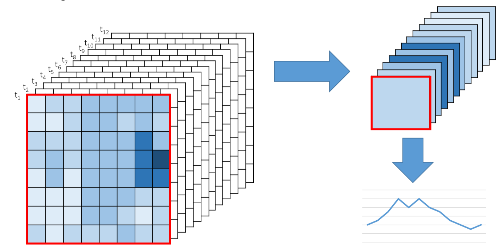
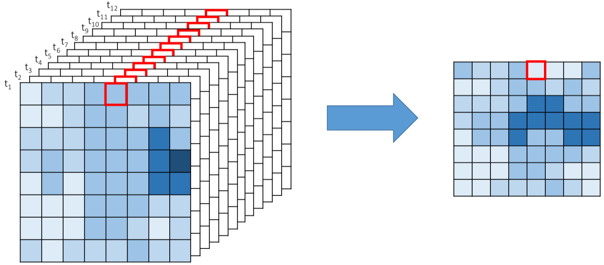

```{r setup, include=FALSE}
knitr::opts_chunk$set(collapse =TRUE, size = "\\scriptsize")
options(tinytex.verbose = TRUE)
library(terra)
library(sf)
```

# Objective and contents

## Objective and contents

**Objective**: to perform basic spatio-temporal statistics using gridded and vector data

>- Raster statistics
>    - Minimum, maximum, mean, standard deviation, sum
>    - Frequency of cells in a raster
>    - Writing derived values as a time series
>- Example: Raster statistics over an area 
>    - Calculating mean P and Ea over an area
>    - Analysing P minus Ea patterns

# Raster statistics

## Raster Statistics

First, we will start with some basic raster statistics. For this, we need to load the terra
package in R:
```{r, eval=FALSE}
library(terra)
```

Please load the following raster of the global monthly average temperatures for the month of February.
```{r, eval=FALSE}
temp_feb_path <- "C:/Users/Temperature_Data/wc2.1_2.5m_tavg_02.tif"
temp_feb      <- rast(temp_feb_path)
```
```{r, echo=FALSE}
temp_feb_path <- "../Data/L5_Spatial_and_Temporal_Statistics_Data/Temperature/wc2.1_2.5m_tavg_02.tif"
temp_feb      <- rast(temp_feb_path)
```

Note that the data are provided in degrees Celsius.

## Raster Statistics

Let's start by looking at the data:
```{r fig.align='center', fig.height=4}
plot(temp_feb)
```

## Raster Statistics

```{r fig.align='center', fig.height=4}
hist(temp_feb)
```

## Minimum and Maximum Values

We can extract the minimum and maximum values of a raster:
```{r}
minmax(temp_feb)
```

## Minimum and Maximum Values

If we just want to check the minimum and maximum values (i.e., not save the number or use it in a calculation), these values come up when you type the name of the raster and hit enter.
```{r}
temp_feb
```

## Grid cells with Specific Attributes

To find out the number of cells with a certain value, we can use the *freq* function.
```{r eval=FALSE}
freq(x, digits = 0, value = NULL, ...)
```

**x**: raster layer

**digits**: used to round the grid-cell values

**value**: optional single value to only count the number of cells with that value

## Grid cells with Specific Attributes

If we don't specify a value or a rounding condition:
```{r}
freq(temp_feb)
```

## Grid cells with Specific Attributes

Now, let's define only looking for NA cells:
```{r}
freq(temp_feb, value = NA)
```

And let's look for 20 degrees, but within rounding margin of 0.1 (note, that means only
values from 19.95 to 20.05).
```{r}
freq(temp_feb, digits = 1, value = 20)
```

## Writing derived values as time series

Let's use what we just learnt to write a time series for global monthly mean temperature over the 12 months for which we have data (over land areas, because oceans are stored as NA).

We will start by loading the rasters and creating a raster stack with all 12 rasters:
```{r, eval=FALSE}
t_path <- "C:/Users/Temperature"
t_files <- list.files(t_path, full.names = TRUE)
t_stack <- rast(t_files)
```
```{r echo=FALSE}
t_path <- "../Data/L5_Spatial_and_Temporal_Statistics_Data/Temperature/"
t_files <- list.files(t_path, full.names = TRUE)
t_stack <- rast(t_files)
```

## Writing derived values as time series

Now we want to calculate the mean value in each layer:
```{r}
mean_values <- global(t_stack, stat = mean, na.rm = TRUE)
print(mean_values)
```

## Writing derived values as time series

<center>
**Question:** Because of the projection system for the data in this example (WGS84), will the results be representative of the global mean temperature averages over land or will they be biased? If they are biased, in which way (i.e., are the results of our analysis higher or lower that the actual average temperature over land)?
</center>

## Writing derived values as time series

Let's plot the outputs.
```{r eval=FALSE}
plot(1:12, mean_values$mean, type = "l", xaxt = "n", xlab = "Month", ylab = "Temp [deg. C]")
axis(1, 1:12, month.abb)
```

**xaxt = "n"** is to not include labels on the x-axis. This is because we want to plot the month abbreviations (see next line) instead of a default 1 to 12.

**month.abb** is a predefined object in R that has the abbreviations for each month.

## Writing derived values as time series

```{r fig.align='center', fig.height=5, echo=FALSE}
plot(1:12, mean_values$mean, type = "l", xaxt = "n", xlab = "Month", ylab = "Temp [deg. C]")
axis(1, 1:12, month.abb)
```

## Writing derived values as time series

Finally, we want to export these values as a time series.
```{r, eval=FALSE}
write.table(mean_values, "C:/User/Exported_TS.csv", row.names = FALSE, sep = ",")
```

## Summary of what the process

We have just shown you how to calculate the mean value (or another variable) for each time step. Then we have generated a time series for the 12 months with one value for each month-

<center>
{width=60%}
</center>

## Next step

Now, we want to calculate the mean annual temperature at each grid-cell. We will calculate the mean of the 12 values that correspond to the 12 months for every grid-cell.

<center>
{width=60%}
</center>

## Calculating mean values at each grid-cell

We will use the same temperature data that we used in the previous example. This time, instead of *global*, we can use the *mean* function.
```{r fig.align='center', fig.height=3}
mean_raster <- mean(t_stack)
plot(mean_raster)
```

## Visualising NA Values in a Raster File

Sometimes it is useful to visualise the location of NA values, for this purpose we can use
the *colNA* parameter from the plot function.
```{r fig.align='center', fig.height=3}
plot(mean_raster, colNA = "red")
```

# Example: Raster Statistics over an Area (P minus Ea)

## Raster Statistics over an Area

For this exercise, we want to look at precipitation and evapotranspiration patterns over
Uganda. We have the following data:

- The shapefile for the Nile Basin countries
- Global monthly P from CHIRPS for 2018
- Monthly Ea over Africa from SSEBop

**We want to generate a line chart for mean monthly P and mean Ea over Uganda**

## Raster Statistics over an Area

**Step 1:** Load the required packages into R.
```{r, eval=FALSE}
library(sf)
library(terra)
```

**Step 2:** Set the paths for the shapefile and the folders with the CHIRPS and SSEBop data.
```{r, eval=FALSE}
dir <- "C:/Users/L5_Spatial_and_Temporal_Statistics_Data"
```
```{r echo=FALSE}
dir <- "../Data/L5_Spatial_and_Temporal_Statistics_Data"
```

```{r}
shape_path  <- file.path(dir, "Shapefile/Nile_Basin_Countries_GAUL2014_2.shp")
chirps_path <- file.path(dir, "CHIRPS")
ssebop_path <- file.path(dir, "SSEBop")
```

## Raster Statistics over an Area

**Step 3:** Read the shapefile and extract the polygon corresponding to Uganda.
```{r}
countries <- read_sf(shape_path)
uganda    <- countries[5,]
uganda <- vect(uganda)
```

## Raster Statistics over an Area

```{r fig.align='center', fig.height=4}
plot(uganda)
```

## Raster Statistics over an Area

**Step 4:** Create a stack of the monthly CHIRPS files.
```{r fig.align='center', fig.height=3}
chirps_files <- list.files(chirps_path, full.names = TRUE)
chirps       <- rast(chirps_files)
plot(chirps)
```

## Raster Statistics over an Area

We want to calculate the mean monthly precipitation over Uganda. That means that we only want to calculate raster statistics within this shapefile. What is one way to do this?

- Mask the raster to the shapefile (not clip!)
- Calculate statistics using this masked raster

But, if we look for other options, we can see that there is a function that already performs this process for us: the extract function (in the **terra** package).

## Raster Statistics over an Area

**Step 5:** Extract the monthly mean precipitation over Uganda.
```{r}
ug_pmean <- terra::extract(chirps, uganda, fun = mean, na.rm = TRUE)
```

If we look at our output, we can see that it is stored as a matrix. The first value should be removed.
```{r}
print(ug_pmean)
```

Let's convert the output to a numeric vector so the values are easier to handle.
```{r}
ug_pmean <- as.numeric(ug_pmean)[-1]
print(ug_pmean)
```

## Raster Statistics over an Area

**Step 6:** Repeat the same process for the Ea data: first create a raster stack and then
extract the monthly mean Ea.
```{r fig.align='center', fig.height=3}
ssebop_files <- list.files(ssebop_path, full.names = TRUE)
ssebop       <- rast(ssebop_files)
plot(ssebop)
```

## Raster Statistics over an Area

```{r}
ug_eamean <- terra::extract(ssebop, uganda, fun = mean, na.rm = TRUE)
ug_eamean <- as.numeric(ug_eamean)[-1]
print(ug_eamean)
```

## Raster Statistics over an Area

**Step 7:** Create a line chart for mean monthly P and mean Ea over Uganda.

First, we start by just plotting the mean monthly P.
```{r eval=FALSE}
plot(1:12, ug_pmean, type = "l", main = "Monthly Mean P and Ea for Uganda - 2018",
col = "blue", lwd = 2, xlab = "Month", ylab = "P and Ea [mm]", xaxt = "n")
```

Next, we can add the Ea using the lines command.
```{r eval=FALSE}
lines(1:12, ug_eamean, col = "darkred", lwd = 2)
```

## Raster Statistics over an Area

Finally, we can include the month abbreviations on the x-axis, gridlines and a legend.
```{r eval=FALSE}
axis(1, 1:12, month.abb)
grid()
legend("topright", c("P", "Ea"), lty = 1, col = c("blue", "darkred"))
```

## Raster Statistics over an Area
```{r echo=FALSE, fig.align='center', fig.height=5}
plot(1:12, ug_pmean, type = "l", main = "Monthly Mean P and Ea for Uganda - 2018",
col = "blue", lwd = 2, xlab = "Month", ylab = "P and Ea [mm]", xaxt = "n")
lines(1:12, ug_eamean, col = "darkred", lwd = 2)
axis(1, 1:12, month.abb)
grid()
legend("topright", c("P", "Ea"), lty = 1, col = c("blue", "darkred"))
```

## Raster Statistics over an Area

For the exercise shown in the lecture slides, we will generate three more outputs:

a) Boxplot for monthly Ea over Uganda

b) Raster spatial distribution of annual accumulated P minus Ea over Uganda

c) Histogram of annual accumulated P minus Ea values over Uganda

## Raster Statistics over an Area

To be able to complete our three extra objectives, we want to create masked monthly P and Ea rasters over Uganda.

Use the mask function to generate the monthly P and Ea rasters.

```{r}
uganda_prec <- crop(chirps, uganda, snap = "OUT")
uganda_prec <- mask(uganda_prec, uganda)
```

```{r}
uganda_ea <- crop(ssebop, uganda, snap = "OUT")
uganda_ea <- mask(uganda_ea, uganda)
```

## Raster Statistics over an Area
```{r fig.align='center', fig.height=4}
plot(uganda_prec)
```

## Raster Statistics over an Area
```{r fig.align='center', fig.height=4}
plot(uganda_ea)
```

## Raster Statistics over an Area - a)

Generate a boxplot to show the dispersion of the Ea values for every month.
```{r fig.align='center', fig.height=3}
boxplot(uganda_ea, main = "Monthly Ea for Uganda - 2018", col = "red", xlab = "Month", ylab = "Ea [mm]", xaxt = "n")
axis(1, 1:12, month.abb)
grid()
```

## Raster Statistics over an Area - b)

To calculate P minus Ea for 2018, we first must compute the annual accumulated P and Ea for Uganda.

Generate rasters for the annual accumulated P and Ea
```{r}
annual_prec <- sum(uganda_prec)
annual_ea   <- sum(uganda_ea)
```

## Raster Statistics over an Area - b)

```{r fig.align='center', fig.height=4}
plot(annual_prec, main = "Annual P for 2018")
```

## Raster Statistics over an Area - b)

```{r fig.align='center', fig.height=4}
plot(annual_ea, main = "Annual Ea for 2018")
```

## Raster Statistics over an Area - b)

Resample the P raster to the same spatial resolution as the Ea raster.
```{r}
annual_prec <- resample(annual_prec, annual_ea, method = "bilinear")
```

Calculate annual accumulated P minus Ea over Uganda.
```{r}
p_minus_ea <- annual_prec - annual_ea
```

## Raster Statistics over an Area - b)

```{r fig.align='center', fig.height=4}
plot(p_minus_ea, main = "P - Ea for 2018")
```

## Raster Statistics over an Area - c)

Plot a histogram of the distribution of annual accumulated P minus Ea values.
```{r fig.align='center', fig.height=3}
hist(p_minus_ea)
```

## Plotting Shape Files and Rasters

Remember, if you are more comfortable plotting shape files and rasters using another programme (eg. ArgGIS, QGIS, Google Earth Engine), this can still easily be done. Just remember that you need to write your results first (i.e., save the outputs).

<center>
{width=70%}
</center>
