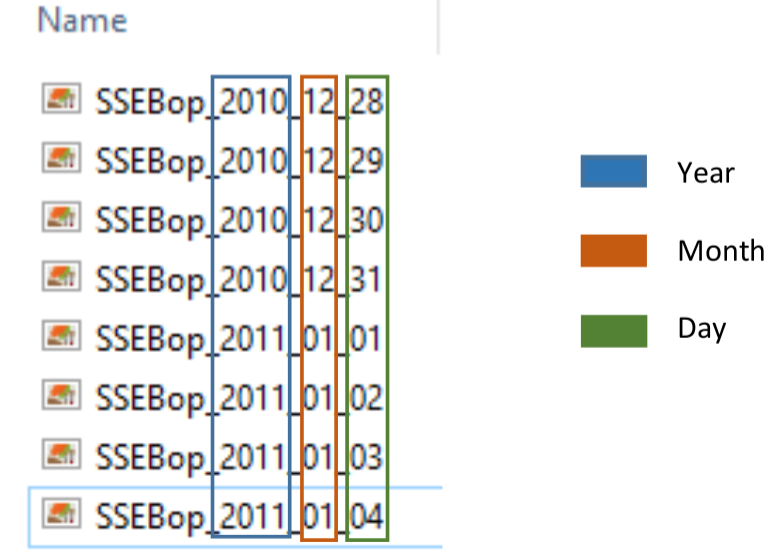
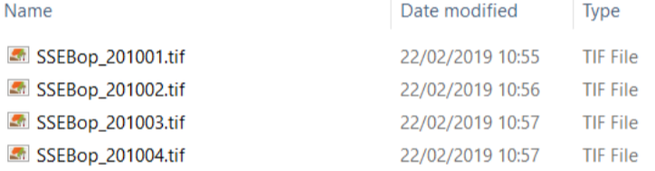
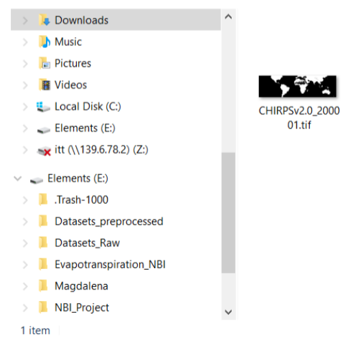
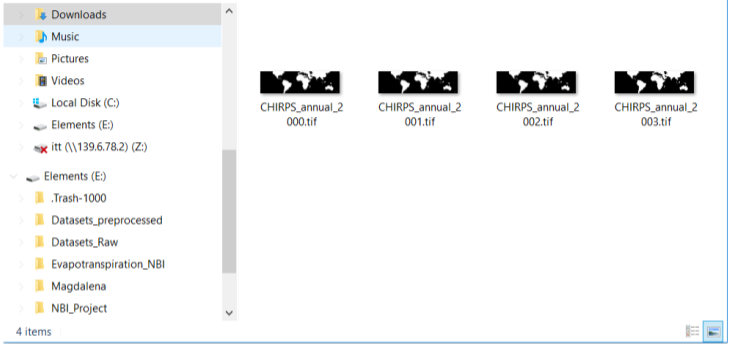
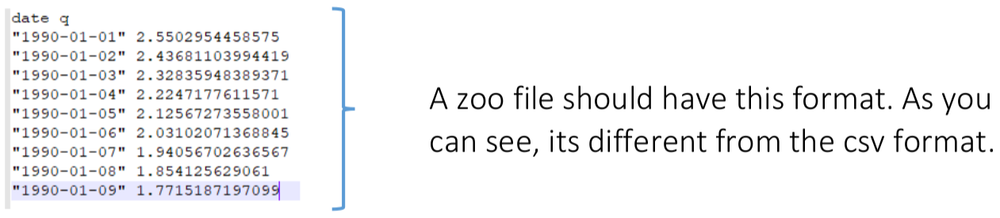

```{r setup, include=FALSE}
knitr::opts_chunk$set(collapse =TRUE, size = "\\scriptsize")
options(tinytex.verbose = TRUE)
library(terra)
library(hydroTSM)
```

# Objective and contents

## Objective and contents

**Objective**: to gain insights related to the organisation and pre-processing of gridded data as well as to work with time series data.

> - Data organisation
> - Accessing and importing particular files
> - Pre-processing data
> - Aggregating data
> - Generation of time series from gridded datasets
> - Extra Considerations

# Data organisation

## Data organisation

Data organisation is the practice of classifying and organising data to make it more usable. 

> - Consistent and clear names 

> - File titles as short as possible

> - Consistent version control

> - Creation of data dictionaries 

## Data organisation

It is preferable to save files (corresponding to a time series) with the date (and/or time
of day) in the name because:

> -  The files will be accessed in the correct order

> -  It is easier to apply general codes

> -  We are less likely to make errors

## Data organisation

The alphabetical organisation of files should correspond to the chronological order of the files.

- Therefore, the year should come before the month and then the month before the date

<center>
{width=40%}
</center>

## Data organisation

File name consistency (length and style).

- We suggest that each file for a certain dataset should have the same base and then a numeric identifier (for date, iteration number, scenario, etc.)

- To ensure the same length of file names, months and days from 1 to 9 should
be written from 01 to 09

Exporting tables (csv, txt, zoo, etc.).

- Same data always in the same location (i.e. in the same row or column)

- Make sure that values with no data are not recorded as zeroes!

# Accessing and importing particular files

## Accessing and importing particular files

Sometimes we only want to use particular files for a certain analysis. Therefore, it is useful to learn how to subset data from a directory.

We have already seen that we can list all of the files within a folder:
```{r, eval=FALSE}
ssebop_files <- list.files("C:/User/SSEBop", full.names = TRUE)
```
```{r, echo=FALSE}
ssebop_files <- list.files("../Data/L4_Data_Processing_Data/SSEBop/", full.names = TRUE)
```

<center>
{width=60%}
</center>

## Selecting Particular Files in R

To select a subset of these files we can use the *grep* function. This functions looks for a predefined pattern in the files and returns the position of each element.
```{r}
grep("2011", basename(ssebop_files))
```

If the base name of the files does not contain the pattern, we could use the entire path and the parameter *value* as follows:
```{r}
grep("2011", ssebop_files, value = TRUE)
```

## Selecting Particular Files in R

In the case that we want to use the vector of positions, we have to subset the vector of files as follows:
```{r}
pos         <- grep("2011", basename(ssebop_files))
ssebop_2011 <- ssebop_files[pos]
head(ssebop_2011)
```

This could be done in one line:
```{r, eval=FALSE}
ssebop_2011 <- ssebop_files[grep("2011", basename(ssebop_files))]
```

## Selecting Particular Files in R

What if we only want the files for every March?
```{r}
ssebop_march <- ssebop_files[grep("03.tif", basename(ssebop_files))]
head(ssebop_march)
```

This works because file names are logical and consistent!

# Pre-processing data

## Pre-processing data

We typically need to pre-process raw data so that it can be used in the way that we require.

- To pre-process data, we need to know how the raw data is stored
- This means we need to find out some or all of the following:
  - Whether a scaling (and/or offset) factor needs to be applied
  - What are the units
  - How NA values have been stored
- Projection system
- In this example, we will look at the CHIRPSv2 precipitation product

## Pre-processing CHIRPSv2

Load the CHIRPSv2 precipitation monthly raw data for January, 2000.
```{r, eval=FALSE}
chirps_path <- "C:/User/CHIRPS_raw/chirps-v2.0.2000.01.tif"
```
```{r, echo=FALSE}
chirps_path <- "../Data/L4_Data_Processing_Data/CHIRPS_raw/chirps-v2.0.2000.01.tif"
```

Now, we can import the raster using the **terra** package.
```{r, eval=FALSE}
library(terra)
```
```{r}
chirps_raw <- rast(chirps_path)
```

## Pre-processing CHIRPSv2

```{r fig.align='center', fig.height=4}
plot(chirps_raw)
```

## Pre-processing CHIRPSv2

CHIRPSv2 only provides in-land precipitation. NA values (i.e., where no estimate is made) are stored in the raw data as equal to -9999.

- So how can we create a dataset that we can then use everywhere?

```{r fig.align='center', fig.height=2.5}
chirps_raw[chirps_raw == -9999] <- NA
plot(chirps_raw)
```

## Pre-processing CHIRPSv2

Now that the data has been pre-processed, we can save it as a new raster.
```{r, eval=FALSE}
writeRaster(chirps.raw, "C:/User/Result/CHIRPSv2.0_200001.tif", overwrite = TRUE)
```

<center>
{width=30%}
</center>

# Aggregating data

## Aggregating data

Sometimes, we have to aggregate data for analysing different temporal scales. One product can be retrieved at daily scale but monthly or annual estimates may be required. In this example, we want to derive an annual precipitation raster from the monthly CHIRPS rasters for the years 2000-2003.

- In this example, we will deal with raster files that are already pre-processed (i.e., the -9999 values have already been converted to NAs)
```{r, eval = FALSE}
chirps_files <- list.files("C:/User/CHIRPS_monthly", full.names = TRUE)
```
```{r, echo = FALSE}
chirps_files <- list.files("../Data/L4_Data_Processing_Data/CHIRPS_monthly", full.names = TRUE)
```

## Aggregating data

```{r}
head(chirps_files)
tail(chirps_files)
```

## Aggregating data

Now, we want to generate annual raster files by adding the 12 monthly files for each year.

- We need first to extract the years from the filenames
```{r}
years <- substr(basename(chirps_files), 15, 18)
print(years)
```

- Now, we will use the unique function to get the different years included in our vector
```{r}
unique_years <- unique(years)
print(unique_years)
```

## Aggregating data

How can we write a for loop to generate one annual raster file at a time?
```{r, eval=FALSE}
output_dir <- "C:/User/CHIRPSv2_annual"

for(i in 1:length(unique_years)){
  # Here we extract the paths of the year i
  positions <- grep(unique_years[i], basename(chirps_files))
  files     <- chirps_files[positions]
  
  # Then we stack the monthly files of the year i
  files <- rast(files)
  
  # Now we have to add the monthly precipitation to get the annual precipitation
  annual <- sum(files)

  # Finally we can export the file. However, we first have to create a different (and identifiable)
  # name for each year. So we will include the year into the new file name.
  name          <- paste0("CHIRPS_annual_", unique_years[i])
  names(annual) <- name
  name          <- paste0(name, ".tif")
  writeRaster(annual, file.path(output_dir, name), overwrite = TRUE)
}
```

## Aggregating data

If you want to look at how it is working step by step we suggest setting i = 1 (or any other number, and then running each step individually and printing/plotting the results after each step.
```{r, echo=FALSE}
output_dir <- "../Data/L4_Data_Processing_Data/CHIRPS_annual"
```

```{r}
i <- 1
positions <- grep(unique_years[i], basename(chirps_files))
print(positions)
files <- chirps_files[positions]
head(files)
```

## Aggregating data

```{r}
files <- rast(files)
print(files)
annual <- sum(files)
```

## Aggregating data

```{r fig.align='center', fig.height=4}
plot(annual)
```

## Aggregating data

```{r}
name          <- paste0("CHIRPS_annual_", unique_years[i])
names(annual) <- name
name <- paste0(name, ".tif")
print(name)
writeRaster(annual, file.path(output_dir, name), overwrite = TRUE)
```

Let's have a look at what is now saved in the CHIRPS_annual folder.

<center>
{width=40%}
</center>

## Aggregating data

Now, in R:
```{r}
annual_files <- list.files(output_dir, full.names = TRUE)
print(annual_files)
```

Let's plot the annual rasters.
```{r}
annual_files <- rast(annual_files)
```

## Aggregating data
```{r fig.align='center', fig.height=4}
plot(annual_files)
```

## The %in% command

We could also have used the *%in%* command in the previous example. This command returns the positions of specific values in a vector.
```{r}
a <- c(10, 10, 20, 20, 30, 30, 40, 40)
a %in% 20
```

If we use the %in% command in combination with the which command:
```{r}
which(a %in% 20)
```

## The Previous Example with the %in% Command
```{r, eval=FALSE}
for(i in 1:length(unique_years)){
  positions <- which(years %in% unique_years[i])
  files <- chirps_files[positions]
  
  # Then we stack the monthly files of the year i
  files <- rast(files)
  
  # Now we have to add the monthly precipitation to get the annual precipitation
  annual <- sum(files)
  
  # Finally we can export the file. However, we first have to create a different (and identifiable)
  # name for each year. So we will include the year into the new file name.
    name          <- paste0("CHIRPS_annual_", unique_years[i])
  names(annual) <- name
  name          <- paste0(name, ".tif")
  writeRaster(annual, file.path(output_dir, name), overwrite = TRUE)
}
```

# Generation of time series from gridded datasets

## Processing Time Series Data

In many instances, we will be working with long time series and will want to extract data over a particular period. We have already looked at how to extract data from particular columns (see example from L2).

Here, we will look at subsetting data according to period and calculating monthly statistics. For this purpose, we will use the **hydroTSM** package, which is designed to efficiently handle time series. Even though **hydroTSM** was designed for the field of hydrology, it is an efficient package for managing time series, regardless of the scientific field in which we are working.
```{r, eval=FALSE}
install.packages("hydroTSM")
library(hydroTSM)
```

## The zoo Package

The zoo package is useful when we have to work with time series. While the *read.table* or *read.csv* commands return the dates in the respective column, the zoo object includes the dates in the index of the object.
<center>
{width=60%}
</center>

Please note that the hydroTSM package loads the zoo package

## Reading the Data

We will first read the csv file:
```{r, echo=FALSE}
temp_data <- read.csv("../Data/L4_Data_Processing_Data/Daily_Temperature.csv")
```
```{r, eval=FALSE}
temp_data <- read.csv("C:/User/Daily_Temperature.csv")
```
```{r}
head(temp_data)
dim(temp_data)
summary(temp_data)
```

## NA values

The NA values have been saved as this text string in the csv file provided (#N/A). We will reread the csv file, specifying the *na.strings* parameter to interpret the NAs correctly.
```{r, eval=FALSE}
temp_data <- read.csv("C:/User/Daily_Temperature.csv", na.strings = "#N/A")
```
```{r, echo=FALSE}
temp_data <- read.csv("../Data/L4_Data_Processing_Data/Daily_Temperature.csv", , na.strings = "#N/A")
```

```{r}
head(temp_data)
```

## NA values

```{r}
tail(temp_data)
summary(temp_data)
```


## Conversion to a Zoo Object

We will use the zoo function to convert the object temp.data to a zoo object.
```{r, eval=FALSE}
zoo(x, order.by)
```

For our example:
```{r}
temp_data <- zoo(temp_data[, c(2, 3)], order.by = as.Date(temp_data[, 1]))
```

## Conversion to a Zoo Object

The dates do not correspond to a column of data! There are only two columns (tmax and tmin).
```{r}
head(temp_data)
summary(temp_data)
dim(temp_data)
```


## Conversion to a Zoo Object

To access the dates, we use the *index* function.
```{r}
dates <- index(temp_data)
head(dates)
tail(dates)
index(temp_data)[3:5]
```

## Extracting Data for a Time Window

We can use the window function to extract data over a particular time period.
```{r}
temp_1990s <- window(temp_data, start = "1990-01-01", end = "1999-12-31")
summary(temp_1990s)
```

## Monthly Statistics

We can use the daily2monthly function to calculate statistics for each month.
```{r, eval=FALSE}
daily2monthly(x, FUN, na.rm = TRUE/FALSE)
```

**x**: is the zoo object
**FUN**: function to be applied
**na.rm**: logical. Shoul the NAs be removed?

Note that the hydroTSM package includes conversions to monthly, seasonal and annual values.

## Monthly Statistics

For our example, let's calculate the mean tmax and tmin for each month of the 1990s.
```{r}
monthly_temp1990s <- daily2monthly(temp_1990s, mean, na.rm = TRUE)
head(monthly_temp1990s)
summary(monthly_temp1990s)
```

## Visualisation of time series

To visualise the time series stored in a zoo object as a plot:
```{r fig.align='center', fig.height=4}
plot(monthly_temp1990s)
```

# Extra Considerations

## Temporary files

Now that you have already processed some large data on your computer, let's have a look at how much space has been used up in writing temporary files.

- Go to the following file path in File Manager: C:\Users\username\AppData\Local\Temp

- If you're analysing large amounts of data, the temporary files will start taking up a
lot of room on your computer. There are a few options:

  1. Periodically delete temporary files from your computer
    
  2. Tell R to write the raster temporary files to another location (e.g., an external drive). You will still need to delete them later. Note that this is only for the raster files.

## Temporary files

To change the directory where the temporary files are stored you can use the *rasterOptions* function.
```{r, eval=FALSE}
rasterOptions(tmpdir = "file path where temporary raster files will be stored")
```

Additionally, you could add code to delete temporary files. This can be done with the *file.remove* function.

## Parallel computation in R

Each core of a CPU can perform operations separately from the others. If no special instructions are given, R will only use one computer core. If you need to process very large amounts of data, please look at the following links:

- [How to speed up R code: an introduction](https://arxiv.org/pdf/1503.00855.pdf)
- [Quick Intro to Parallel Computing in R](https://nceas.github.io/oss-lessons/parallel-computing-in-r/parallel-computing-in-r.html)
- [Parallel Processing in R](http://dept.stat.lsa.umich.edu/~jerrick/courses/stat701/notes/parallel.html)
- [Parallel Computation - Data Science](https://bookdown.org/rdpeng/rprogdatascience/parallel-computation.html)
