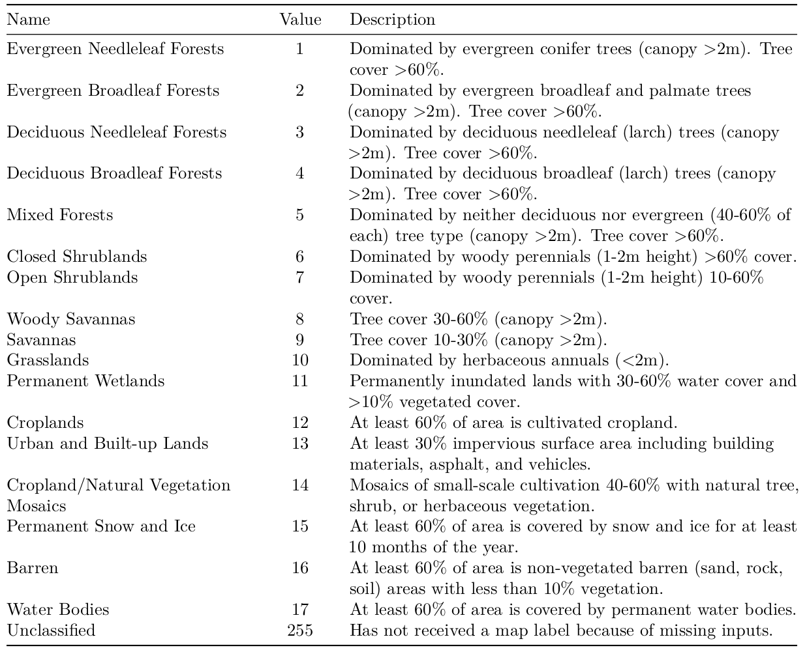

```{r setup, include=FALSE}
library(terra)
```

## Welcome

Welcome to the third tutorial of the R Beginners Course of Spatial analysis. We hope that you are ready to try some things out!

## Outline

This tutorial is composed by one exercises:

* Analysing Ea estimates over agricultural areas in Ethiopia.

After the completion of this tutorial you will be able to process gridded datasets and produce useful information from them.

## Analysing Ea estimates over agricultural areas in Ethiopia

The MODIS Land Cover product (MOD12Q1) incorporates five different land cover classification schemes. The principal land cover scheme identifies 17 land cover classes defined by the International Geosphere-Biosphere Programme (IGBP; Loveland and Belward 1997), as observed in Table 1. This product has a spatial resolution of 500 m with global coverage and at annual temporal resolution.

<center>
<scriptsize> Table 1: Detailed information of the IGBP land cover classes.</scriptsize>


</center>

```{r fig.align='center', echo=FALSE, fig.cap="Figure 1: MOD12Q1 land cover according to the IGBP classification (Loveland et al., 1997)."}
f <- "../Data/Exercise_3/MODIS_land_cover_2017/MCD12Q1_LC1_2017_001.tif"
f <- rast(f)
plot(f)
```

### Objective of the task

For this exercise the students should:

 a) Calculate the percentage of cropland area over Ethiopia for 2017. Note that more than one
land cover classification must be considered.

 b) Obtain monthly time series of the maximum, mean, minimum, standard deviation, and median Ea values over the cropland areas.

 c) Create a boxplot (i.e., one ‘box’ for every month of the year) showing the monthly distribution
of Ea values over the cropland areas of Ethiopia for 2017.

### Material

In the data for this exercise there are three folders:

 a) SSEBop_2017: this folder contains 12 monthly raster files of the SSEBop Ea product for 2017.
 
 c) MODIS_land_cover_2017: this folder contains the MOD12Q1 product according to the IGBP land cover classification for 2017.
 
 d) Ethiopia_shapefile: this folder contains the shapefile of Ethiopia in WGS84 coordinate system.

### References

* Loveland, Thomas R, and AS Belward. 1997. “The International Geosphere Biosphere Programme Data and
Information System Global Land Cover Data Set (Discover).” Acta Astronautica 41 (4-10). Elsevier: 681–89.