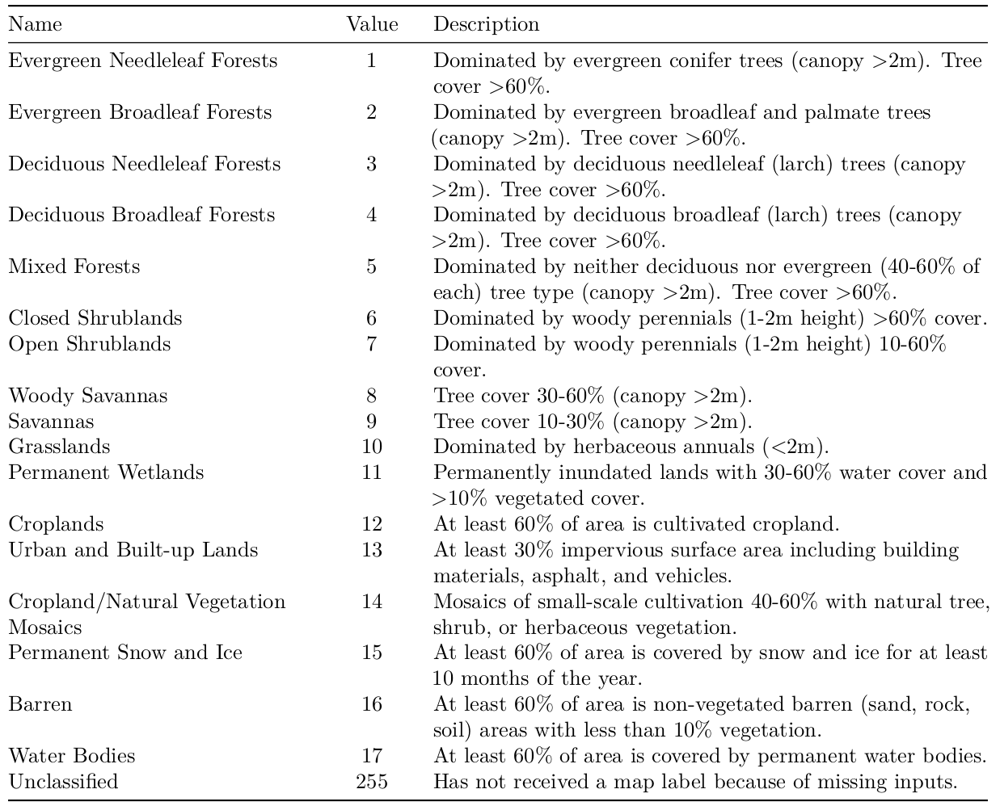

```{r setup, include=FALSE}
library(terra)
```

## Welcome

Welcome to the third tutorial of the R Beginners Course of Spatial analysis. We hope that you are ready to try some things out!

## Outline

This tutorial is composed by one exercises:

* Analysing Ea estimates over agricultural areas in Ethiopia.

After the completion of this tutorial you will be able to process gridded datasets and produce useful information from them.

## Analysing Ea estimates over agricultural areas in Ethiopia

The MODIS Land Cover product (MOD12Q1) incorporates five different land cover classification schemes. The principal land cover scheme identifies 17 land cover classes defined by the International Geosphere-Biosphere Programme (IGBP; Loveland and Belward 1997), as observed in Table 1. This product has a spatial resolution of 500 m with global coverage and at annual temporal resolution.

<center>
<scriptsize> Table 1: Detailed information of the IGBP land cover classes.</scriptsize>


</center>

```{r fig.align='center', echo=FALSE, fig.cap="Figure 1: MOD12Q1 land cover according to the IGBP classification (Loveland et al., 1997)."}
f <- "../Data/Exercise_3/MODIS_land_cover_2017/MCD12Q1_LC1_2017_001.tif"
f <- rast(f)
plot(f)
```

### Objective of the task

For this exercise the students should:

 a) Calculate the percentage of cropland area over Ethiopia for 2017. Note that more than one
land cover classification must be considered.

 b) Obtain monthly time series of the maximum, mean, minimum, standard deviation, and median Ea values over the cropland areas.

 c) Create a boxplot (i.e., one ‘box’ for every month of the year) showing the monthly distribution
of Ea values over the cropland areas of Ethiopia for 2017.

### Material

In the data for this exercise there are three folders:

 a) SSEBop_2017: this folder contains 12 monthly raster files of the SSEBop Ea product for 2017.
 
 c) MODIS_land_cover_2017: this folder contains the MOD12Q1 product according to the IGBP land cover classification for 2017.
 
 d) Ethiopia_shapefile: this folder contains the shapefile of Ethiopia in WGS84 coordinate system.

### Solution

First let’s write the path of the folder where all the data is stored and relate the specific paths of the products that we will use to it. We will also load the packages required.
```{r, eval=FALSE}
library(terra)
dir <- "C:/Users/obaezvil/sciebo/R5_Spatial_and_Temporal_Statistics_Data/Data_exercise"
```
```{r, echo=FALSE}
dir <- "../Data/Exercise_3"
```

```{r}
lc_path       <- file.path(dir, "MODIS_land_cover_2017", "MCD12Q1_LC1_2017_001.tif")
ethiopia_path <- file.path(dir, "Ethiopia_shapefile", "Ethiopia.shp")
ssebop_folder <- file.path(dir, "SSEBop_2017")
```

We can read the shapefile of Ethiopia, the land cover layer and stack the SSEBopdata.
```{r, fig.align='center'}
# Ethiopia shapefile
ethiopia <- vect(ethiopia_path)
plot(ethiopia, axes = TRUE)
```

```{r}
# Land cover for 2017
lc <- rast(lc_path)
plot(lc)
lines(ethiopia)
```

```{r, fig.align='center'}
# SSEBop product for 2017
ssebop_files <- list.files(ssebop_folder, full.names = TRUE)
ssebop       <- rast(ssebop_files)
ssebop       <- crop(ssebop, ethiopia, snap = "out")
plot(ssebop)
```

Now we can crop and mask the land cover layer to the Ethiopian extent.
```{r}
lc <- crop(lc, ethiopia, snap = "OUT")
lc <- mask(lc, ethiopia)
plot(lc)
lines(ethiopia)
```

**Solution A: percentage of croplands**

We will store the values of the masked raster in a vector.
```{r}
values <- values(lc)
summary(values)
```

**NOTE:** The operator *!* can be understood as Not. For example, we have a vector x <- c(1, 1, 1, 2, 2, 3, 4). If we type *which(x %in% 1)*, we will get as a result the positions 1, 2 and 3; however if we type *which(!x %in% 1)*, we will get as a result the position of the values that are not one (i.e., 4, 5, 6 and 7).

Now we have to remove the NA values as we do not have to consider them in the calculation. After this, we obtain the length of the positions where the values match the values 12 or 14 (the cropland areas are represented by these values). Finally, we calculate the area of croplands in percentage.
```{r}
values <- values[!values %in% NA]
crops  <- length(which(values %in% c(12, 14)))
area   <- crops / length(values) * 100
print(area)
```

**Solution B: time series of mathematical functions**

For this point, we have to extract the actual evaporation values only for the crop areas. For this purpose, we will create a mask raster layer using the land cover.
```{r}
mask <- lc
```

Now, we will set the values different to cropland areas (12 and 14) to NAs, while setting the cropland areas values to 1
```{r fig.align='center'}
mask[!mask %in% c(12, 14)] <- NA
mask[mask %in% c(12, 14)]  <- 1
plot(mask)
```

After this, we will resample SSEBop to the same spatial resolution of the mask using the bilinear interpolation. Then, we will multiply the mask with the product to obtain only values over the cropland areas.
```{r fig.align='center'}
ssebop       <- resample(ssebop, mask, method = "bilinear")
ssebop_crops <- ssebop * mask
plot(ssebop_crops)
```

Use the global function to extract the maximum (*max*), mean (*mean*), minimum (*min*), standard deviation (*sd*), and median (*median*) values for each layer.
```{r}
max    <- global(ssebop_crops, max, na.rm = TRUE)
mean   <- global(ssebop_crops, mean, na.rm = TRUE)
min    <- global(ssebop_crops, min, na.rm = TRUE)
sd     <- global(ssebop_crops, sd, na.rm = TRUE)
median <- global(ssebop_crops, median, na.rm = TRUE)
```

Finally, we can create a table of results:
```{r}
result        <- data.frame(month.abb, max,mean, min, sd, median)
names(result) <- c("Months", "max", "mean", "min", "sd", "median")
print(result)
```

**Solution C: Boxplot**

We can use the boxplot function using the ssebop.crops object to show the monthly distribution of actual evaporation over the cropland areas of Ethiopia for 2017.
```{r fig.align='center'}
boxplot(ssebop_crops, main = "Monthly ETa over croplands in Ethiopia, 2017", 
        col = "orangered3", xaxt = "n", ylab = "ETa [mm]")
axis(1, 1:12, month.abb)
grid()
```

### References

* Loveland, Thomas R, and AS Belward. 1997. “The International Geosphere Biosphere Programme Data and
Information System Global Land Cover Data Set (Discover).” Acta Astronautica 41 (4-10). Elsevier: 681–89.